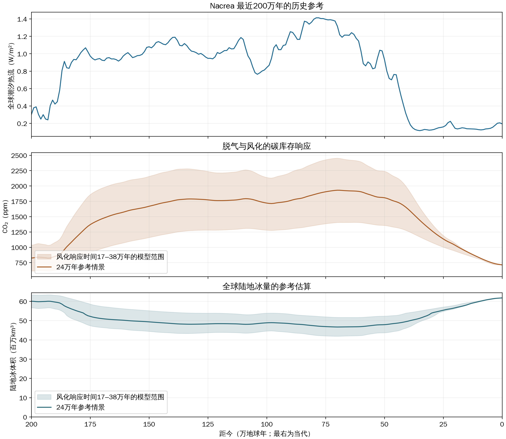

# 0021 — 热流、CO₂与全球冰量历史

## 1. 设定中的历史参考

Nacrea 最近200万年的气候历史采用同一条潮汐热流轨迹，并以当代712 ppm的CO₂浓度为锚点。
这份重建将[0014的四期框架](0014-tidal-heat-long-term-statistics.md#22-四期框架作者-2026-10-15)
展开为连续的历史参考：热流增强时火山脱气增多，新鲜玄武岩与升温同时增强风化；
碳库存的调整使温室增强晚于热流上升，陆地冰量再随积累、消融和冰流输出改变。
历史参考的采用范围是分期、时序和变化量级，现今气候以[0013](0013-climate-canon-source.md)的定版来源为准。

时间均以地球年计，距今零点对应轨道轨迹`CTL045_J2_08_e2`的2367 kyr历元。
参考情景的风化响应时间为24万年，17万年与38万年两种情景提供参数敏感性范围。

图中的热流采用中心2万年平均。CO₂与冰量的阴影表示风化响应时间变化所得的模型范围。
冰量表示全球陆地冰的体积，海冰与漂浮冰架按各自的物理量解释。
图表数据见[历史参考表](assets/0021-heat-co2-ice-history.csv)。

| 距今 | 全球潮汐热流 | CO₂参考浓度 | 全球陆地冰量参考估算 |
|---|---:|---:|---:|
| 200万年 | 0.302 W/m² | 824 ppm | 6000万km³ |
| 150万年 | 1.079 W/m² | 1668 ppm | 4930万km³ |
| 100万年 | 0.841 W/m² | 1720 ppm | 4880万km³ |
| 78万年 | 1.412 W/m² | 1879 ppm | 4710万km³ |
| 70万年 | 1.315 W/m² | 1930 ppm | 4660万km³ |
| 63万年 | 1.222 W/m² | 1917 ppm | 4670万km³ |
| 50万年 | 0.933 W/m² | 1807 ppm | 4780万km³ |
| 20万年 | 0.142 W/m² | 1033 ppm | 5660万km³ |
| 当代 | 0.193 W/m² | 712 ppm | 6170万km³ |

最近一次热流高峰在距今约78万年，CO₂峰值与冰量低谷在约70万年，两者相隔约8万年。
这是该次事件的峰值时差；24万年的风化响应时间描述碳库存回到平衡的速率。
暖期的全球陆地冰量较参考情景的当代值减少约四分之一，仍保留大规模覆冰。
此后CO₂缓慢回落，冰量逐步恢复。当代的低热流和712 ppm对应静息期中的相对冷凉阶段。

356–1400 ppm描述[0012](0012-climate-gcm-calibration.md#7-co₂-变化范围与气候响应作者裁决-2026-10-13)
中的常见变化范围。持续较久的活跃段可进入更高浓度，本次参考暖期约1930 ppm，
仍处于140–3000 ppm的长期情景范围内。

## 2. 三条历史的计算依据

**潮汐热流。** 热流从轨道检查点的累计耗散量差分恢复，最近200万年共201个历史点，间隔1万年。
当代中心2万年平均值为0.19346 W/m²。地质输入`tidal_heat_history.yaml`采用简化的归一化序列，
当代值为0.18 W/m²；该序列的幅度系数为0.92146。本文的历史参考消费检查点核验值，
地质生产继续按其已登记的输入版本计算。

**CO₂。** 简化碳循环用全球潮汐热流相对当代的比率估计脱气供给，
同时以新鲜玄武岩增加风化能力，并计入CO₂浓度、气温和径流对风化的反馈。
新鲜玄武岩的风化份额取0.325，来自地球文献的30%–35%范围；有效风化指数约0.672。
每种响应时间的碳库存均以当代712 ppm归一，历史峰值与日期由库存方程积分求出。
方程、参数类别与资料见[约化碳库存响应](../../../../docs/knowledge/climatology/atmospheric_co2_ch4_history.md#41-热流驱动的约化碳库存响应)。

**全球冰量。** 同版T42的CO₂气候快照提供相对当代的温度变化和降水变化，
叠加到现今定版月气候后，计算全球200k网格上的净积累区。
每个连通区域采用一维平底Vialov等效剖面估计冰量，Vialov剖面以积累、冰的流变与冰体尺度约束厚度。
全局库存方程把积累与消融、冰流及海洋输出合并记账，再沿历史气候积分。
方法见[全球冰量的约化估算](../../../../docs/knowledge/geology/ice_sheets.md#15-全球冰量的约化估算)。

## 3. 数值的采用范围

热流直接来源于轨道轨迹，CO₂与冰量属于在该轨迹上计算的参考重建。
碳模型采用固定的含碳量、脱气效率和海洋与大气之间的碳分配比例，
历史窗口起点的库存取对应气候的平衡状态。参数敏感性情景的CO₂峰值约为1406–2452 ppm。

全球冰量的地球观测气候检查显示绝对量偏大数十个百分点，
冰面高程反馈、基底滑动与实际三维冰流仍有各自的计算范围。
表中的4660万–6170万km³作为历史量级估算；现今画布中的冰厚来自共享球面与细尺度覆冰响应，
两种结果分别按历史库存和当前空间地表解释。
海平面与海峡开合使用[0016](0016-sea-level-gateways.md)的独立依据，
具体峡湾与槽谷还需结合累计覆冰时间、基底热状态和侵蚀过程判断。

这条轨迹提供过去200万年的一份历史。其他初相位的轨迹可有不同的活跃段，
更长时期的规律由0014的集合统计描述，气候分期保留其混沌性质。
