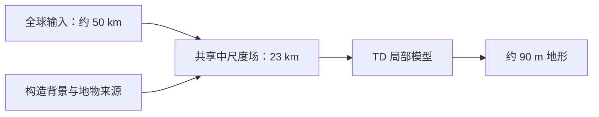

# 画布条件场的构造结构

> **定位**：全球画布链 S1 的条件场改进提案，回应高清画布在大尺度上的问题：山体像金字塔、到处是同一种山、
> 高原内部太平、看不出挤压造山的线状结构，以及总览图上海岸线、陆架与海沟保留网格格子轮廓的颗粒感。引擎的格子平均语义与造山带剖面见
> [orogen-topography.md](orogen-topography.md)；画布链的现行实现见
> [pipelines/canvas-chain.md](../pipelines/canvas-chain.md) 2.5 节。
>
> **状态**：当前生产版本已定版，采用范围见第 4 节的步骤状态表。当前版本使用构造结构增量、地球细节幅度标定，以及所选连续山带来源；新 T42 的长期守恒气候已反馈到 TD，全套两档高清图共用同批原生地形。地形驱动的气候超分辨率、地貌曲线与地表过程扩展继续作为候选，总体需求按各项地貌分别验收。当前实现见画布与气候 pipeline，大河侵蚀与冰川地貌另立提案。

---

## 总体需求

本提案以海岸线细节与大尺度地形的真实感为共同目标，重点处理约一个粗格及以上的中尺度地貌，并保留 S3 已有的局部起伏和边界多样性。以下需求用于各轮方案的共同验收；具体方法见第 4 节，科学与创作验收见第 5 节。

| 对象 | 需求与判读依据 |
|---|---|
| 海岸形态 | 减少圆凸叶片、重复圆弧和粗格轮廓，保留多尺度岬湾、近岸岛屿与窄水道。共同检查局部细节和大陆总览，结合边界多样性判断平滑后的效果。 |
| 跨格水域形态 | 检查两岸、岛链与大陆之间长距离近乎平行的水域，恢复有来源的收窄、展宽、分支与盆地连接。宽度超过约 50 km 的水域也纳入验收，以大陆总览和同坐标海陆轮廓共同判断；浅海色带、海底等深线和实际水道分别归因。 |
| 沿岸平原 | 平原的存在范围、宽度和岸边高程由作者输入、观测近似或地质推导支持。岸距从海岸几何起算，宽度独立于格距；数值试点固定已有宽度输入。真实低地可以恰好约 50 km 宽，验收分别识别自然宽度和第一排粗格整格恒高造成的带状形态。 |
| 海沟与陆缘地形 | 联合检查海沟、岛弧、陆架和弧后盆地的位置、剖面及沿走向的宽度变化，区分地质来源与取样造成的条带。暮光北岸的弧后深盆作为独立地物检查，与外侧海沟分别归因。 |
| 山系与裂谷 | 形成跨越一个旧格以上的连续山带、山前缘、分支、主谷及盆地连接，体现沿走向的宽度变化、两侧不对称、河谷切口和有来源的分段。连续性按地物联系判断，同时保留低鞍部与跨山通道。 |
| 山体与高原 | 改善帐篷、金字塔、中尺度团块和重复台地外缘，区分活跃高山、古老低山与高原等类型，保留局部支脊、谷地和起伏。山系组织与局地起伏分别评价。 |
| 岛屿 | 近岸岛屿及其水道属于海岸形态验收；远洋岛屿作为次要观察项。合理的新增岛屿可以保留，其来源和创作效果分别记录。 |

实现与比较遵循以下约束：

1. **连续来源与粗格表达。** 200k 网格约 50 km 的格距代表输入分辨率。细化以可信的大陆格局、构造背景和重要地物为依据，允许合理的局部海陆变化；总地形按可解析尺度验收。结构增量的格内零均值属于该增量的设计性质，地物几何与总高程另有来源和验收口径。
2. **气候预算。** 降水继续满足父格内的面积水量守恒。地形几何的调整与气候预算分别处理，气候通道保持其物理来源。
3. **S3 基线与单项实验。** 新方案以 S3 为起点，首轮固定模型、种子、高程条件强度和细节幅度，单独检验连续几何的传递。来源场、23 km 条件、共享粗尺度输出和最终地形分别留存，便于定位信息损失。
4. **地球与创作双轨验收。** 地球对照使用相同范围、尺度及可用输入信息量，并以真实 DEM 检查形态；完整 DEM 直接条件或由其提取的精细几何单列为信息更充分的参照。Nacrea 用于检查世界意图与创作效果。
5. **高清图的产品约定。** 地形图同时提供约 180 m 和约 359 m 两份，实际格距分别为 179.6875 m 和 359.375 m。两份使用同一版本、相同范围及配色，由同一原生地形按各自尺度取样，便于核对细节与总览。最终产品目录约定见画布 pipeline 第 2.8 节与第 3.7 节。
6. **联合回归。** 山系实验同时检查南方大陆海岸、曙光沿岸平原和暮光北岸海底地形。各项分别报告，综合判断收益与退化；对比图覆盖局部、区域和总览尺度。
7. **可复现性与性能。** 输入、几何参数和产物记录来源与版本，验证参考态重放、覆盖积分及跨窗一致性。性能按固定硬件、并发数和生成块数比较，首次准备与缓存复用分别计时，并记录内存、显存和缓存占用。

## 1 问题

terrain-diffusion（下称 TD）在 90 m 尺度上给出的细节是可信的，问题都在 20–200 km 的尺度上。TD 在这一尺度上
只跟随条件场，而条件场是全球网格每格（约 54 km）的平均高程：每个粗格在 4 倍细的网格上取最近的网格格，再求
块平均。这个场有三个特点。

1. **均值底场只表达粗格的平均高程。** S3 通过第 2 步的结构增量使用亚格子起伏 `relief_std_m`；
   峰顶高度 `peak_elevation_m` 尚未作为独立条件传入。均值底场与格内峰顶分别记录，结构增量经过空间聚合后的起伏另行检查。
2. **它带着网格格子的平台。** 曙光画布上，相邻陆地粗格中有 16% 的高差小于 1 m；条件场的局部高点平均约
   100 km 一个，约为两个网格格距。
3. **它的大尺度形状来自引擎的楔形剖面。** 造山带的格子平均剖面是两翼坡度恒定的双向楔体，顶部达到上限后展宽成
   高原（`orogen_profile.py`）。这个剖面对格子平均是正确的，但它被原样交给 TD 以后，每条山脉在大尺度上都是一座
   两坡平直的「帐篷」或一块平顶台地。

## 2 证据

用同一套指标比较地球 90 m 高程（Copernicus GLO-90）与 nacrea 画布。每个窗口约 370–440 km 见方，先平均到约 360 m
一像素；山地指高于 1000 m 的像素。

- 10 km 局部起伏：10 km 窗口内的最大高差。
- 走向一致度：2–10 km 波段的结构张量一致度，在 15 km 范围内平均。1 表示山脊互相平行，0 表示没有方向。
- 山峰拉长度：突出山峰周围 300 m 以内的峰体，长短轴之比。约 1 是锥形山，大于 2 是山脊。
- 突出山峰密度：比 20 km 内最低点高出 800 m 以上的局部高点，每万平方千米的个数。

| 窗口 | 10 km 起伏中位数 | 走向一致度 | 山峰拉长度 | 突出山峰密度 |
|---|---:|---:|---:|---:|
| 喜马拉雅前缘（地球） | 1281 m | 0.25 | 2.0 | 69 |
| 喀喇昆仑—兴都库什（地球） | 2166 m | 0.26 | 2.2 | 79 |
| 阿尔卑斯（地球） | 1835 m | 0.21 | 2.1 | 114 |
| 青藏高原内部（地球） | 409 m | 0.30 | 2.2 | 9 |
| 中安第斯高原（地球） | 424 m | 0.27 | 1.7 | 23 |
| nacrea 五块主要大陆的十个最高窗口 | 200–700 m | 0.20–0.31 | 1.6–2.2 | 3–46 |
| nacrea 暮光大陆的两个最高窗口 | 1455–2071 m | 0.18–0.19 | 2.1–2.2 | 101–108 |

读法：

1. **TD 的小尺度形态与地球相当。** 走向一致度与山峰拉长度都落在地球的范围内，锥形山（拉长度小于 1.5）的比例
   也与地球相近。所以「金字塔」不是 7 km 尺度上的锥形山峰，而是更大尺度上的形状，与第 1 节第 3 条一致。
2. **缺的是高起伏山地。** 地球的高山区 10 km 起伏在 1300–2200 m，突出山峰每万平方千米 70–110 个；nacrea 除暮光
   大陆以外，最高的窗口只有 200–700 m 和 3–46 个，读起来都是高原或丘陵。这就是「到处是同一种山」：几乎所有
   山地都落在同一个低起伏的档位上。
3. **高原内部并不比地球平，平的是高原的面积和边缘。** nacrea 高原窗口内部的起伏（177–660 m）与青藏高原（393 m）
   和安第斯高原（232 m）相当；但地球的高原由高起伏的山脉镶边，nacrea 的高原边缘只是楔形剖面的平直斜坡。
4. **暮光大陆是一个线索。** 两块条件场平均高度相近的窗口（北极大陆约 4600 m，暮光大陆约 4560 m），暮光一侧的
   起伏是北极一侧的三倍。两者的差别在气候通道：暮光的窗口在南纬 66–68°，属于极地气候并有冰盖。TD 学到的是地球上高海拔与寒冷气候同时
   出现时的冰蚀高山，所以气温条件本身就能改变它给出的起伏。这条需要单变量对照来确认（第 4 节第 1 步）。

## 3 物理与文献依据

- **起伏有物理上限，也有标定。** 网格已经按 Montgomery 与 Brandon（2002）的阈值坡面关系给出了每格的亚格子起伏
  与峰顶高度，并在地球 2722 个格子上标定过（`subgrid_relief.py`）。条件场应当携带这一信息，而不是只带平均值。
- **山脊沿构造走向排列。** 褶皱轴与逆冲带垂直于主缩短方向（Cordonnier 等 2018，基于地下地质的山地建模）；
  Cortial 等（2019）的程序化构造行星在放大阶段同样按褶皱方向给山脊定向。引擎的汇聚边界段（`orogen_contract.py`）
  记录了接触方向与极性，走向可以直接从中得到。
- **线状山脉的谷口间距是规则的。** Hovius（1996）统计了大量线状山脉：山脉半宽与主谷出口间距之比集中在
  1.91–2.23，即主谷间距约为半宽的一半。这给出了沿走向的主谷波长，不需要作为自由参数。
- **高原由山脉镶边。** 青藏高原与安第斯高原的边缘都是高起伏的山脉（喜马拉雅、昆仑、东科迪勒拉）；高原的
  内部平坦与边缘陡峻是同一套增厚与侵蚀过程的两面。引擎的剖面已经区分了翼部与高原，可以在翼部与高原的交界处
  加上镶边山脉。

## 4 方案

总原则：**细化以可信的大尺度大陆与构造背景为约束，地物形状由连续来源和可解析尺度上的信息决定。**
网格是连续地形的离散表达，地物边界另有几何依据。构造结构增量的格内零均值保留为该增量的设计性质，
重建后的总高程与 TD 输出按各自尺度验收。降水在父格内的面积水量守恒仍是硬约束，与高程几何约束分开。
每一步只新增一个闭合，按第 5 节的指标在地球窗口与 nacrea 上检验。

1. **诊断：TD 对条件场的响应。** 不改产品，只做对照实验。在几个窗口上分别改变一项输入，各生成一次：
   （a）气温通道换成同纬度的寒冷值，检验第 2 节第 4 条；（b）高程通道叠加一个已知方向与波长的正弦山脊，检验 TD
   在 23 km 条件尺度上能保留多少结构；（c）改变高程通道的条件信噪比，检验 TD 贴近条件场的程度与细节质感的
   取舍。这一步决定后面两步做在哪个尺度上、要不要配合信噪比。
2. **构造结构场。** 当前实现沿平滑粗格等高线组织定向带通起伏，幅度取 `relief_std_m` 的 0.52 倍，
   波长由山带半宽与 Hovius 比值估计。格内均值校正和陆地截断后，再聚合到 TD 条件尺度。
   峰顶字段用于幅度诊断；显式峰顶约束、高原边缘镶边及具有来源的主谷几何属于后续候选。
3. **TD 细节幅度标定。** 使用独立地球窗口确定输出残差系数，并在另组窗口检验，当前采用上游值的 2.0 倍，见 4.0 节。
4. **气候尺度传递。** 当前采用父格月预算守恒的有限面积重采样和地形暴露降水增量。
   地形生成条件与附带消费气候分别保存，线性动力降水及局地温度扩展按独立质量验收推进，见 4.1 节。
5. **连续地形来源与取样。** 所选山带使用连续来源和球面覆盖积分，其他区域沿用 S3。
   沿岸固定剖面、沿轴保守传递及其他地貌扩展按各自来源与验收范围处理，见 4.2 节。

| 步骤 | 当前实现与采用 | 保留的范围 |
|---|---|---|
| 第 1 步：TD 响应诊断 | 条件响应对照已完成，结果支持当前高程条件强度。 | 诊断结果用于确定输入尺度，各地貌的效果仍按对应窗口验收。 |
| 第 2 步：构造结构场 | 定向带通增量、格内均值校正和条件聚合已实现并采用。 | 显式峰顶约束、主谷与高原镶边仍需来源和独立验收。 |
| 第 3 步：细节幅度标定 | 地球标定与留出检验已完成，采用统一输出系数。 | 系数的适用域与不确定性沿用标定说明。 |
| 第 4 步：气候尺度传递 | 长期守恒重采样、地形暴露降水增量、水文输入同步及 TD 气候刷新已实现。 | 地形暴露提供有限的区域增益；线性动力地形雨与局地温度扩展继续按独立质量验收。 |
| 第 5 步：连续地形来源 | 所选古山带与活动山带已进入生产，主动陆缘作用域已接入地质合成。 | 连续岸坡与沿轴保守传递获得局部接受；地貌曲线、岛屿连续几何和地表过程仍按候选范围验收。 |

**第 1 步的结论**（2026-10-25，两轮九组对照）：TD 的条件信噪比数值越小、条件越强；高程通道取 0.05 时，800 m、92 km
的注入山脊有一半以上保留下来，起伏与山峰密度达到地球喜马拉雅前缘的水平，而现行的 0.2 只保留 5%，1.0 时完全不理会
高程条件。所以第 2 步的结构场做在 23 km 条件尺度上，并把高程通道的信噪比降到约 0.05，其余通道不变。气温条件对起伏
的影响最大（寒冷高地被画成冰蚀高山），但气温来自 GCM 正典，不作为调节手段。

条件或共享统计场改变时，受影响的画布按新输入重新生成；两档高清图从同一批原生块取样。

### 4.0 第 3 步：TD 细节幅度的地球标定

地球验证表明，TD 即使以真实地形为条件，也只给出地球 10 km 起伏的约 30–60%。TD 在高程的平方根空间里生成地形，
低频骨架与细节残差分开处理，残差在输出时乘一个缩放系数（上游配置的 `residual_std`，1.1678）再平方回高程。这个
系数只作用于输出，不进入模型内部，所以它是校正 TD 输出尺度的合适位置。平方根空间中同样的残差在较高背景上产生
较大的米制起伏，平原响应由留出窗口独立检验。初测：系数乘 2 时，喜马拉雅前缘的 10 km 起伏 p90 与实测相同（2762 m 对 2778 m），阿尔卑斯达到实测的
77%，但阿尔卑斯的突出山峰偏多，最高点仍然偏低（峰顶在低频骨架里，这个系数补不回来）。

**标定设计。** 以「TD 用真实地形的 23 km 块平均为条件、高程信噪比 0.05」为对象，只改这一个系数，让生成结果的纹理
指标接近 Copernicus 实测；这样标定的是 TD 自身的输出偏差，与我们的条件场无关。地点覆盖活跃造山带、古老低山、
高原、干旱山块与平原，并分成两组：

| 组 | 地点 | 地貌与气候 |
|---|---|---|
| 标定 | 喜马拉雅前缘、阿尔卑斯、阿巴拉契亚、安第斯东科迪勒拉与高原北部、提贝斯提 | 湿润活跃造山带、温带冰蚀山地、湿润古老低山、干旱高原与山脉、沙漠火山山块 |
| 检验 | 喀喇昆仑、安第斯普纳高原、青藏高原内部、阿哈加尔、北美大平原 | 寒冷高起伏、干旱高原、高原内部、沙漠古老山块、平原（检查是否放出假起伏） |

每个地点在同一张方位等距画布上生成，实测值按同一窗口从 Copernicus 重采样到 360 m 后计算，统计范围只取两者都有
数据的陆地像素。指标是全部陆地像素的 10 km 起伏中位数与 p90，以及突出山峰密度；系数取标定组对数误差的最小值，
用检验组判断是否过拟合，地点之间最优值的离散作为不确定度。系数归入观测拟合，所有世界使用同一个值。

**第 3 步的结论**（2026-10-25，十个地点、五档系数共 50 组）：系数取上游值的 2.0 倍（`residual_std` 2.3356）。标定组的
平均对数误差从 0.64 降到 0.25；各地点的最优值在 1.5–3.0 之间，作为不确定度。检验组中喀喇昆仑、普纳高原与阿哈加尔
明显改善（1.16 → 0.65、0.70 → 0.22、1.03 → 0.36），北美大平原的起伏放大约 23%（绝对值仍为 60–75 m 级），青藏高原
内部基本不变：高原内部的平坦来自 TD 的低频骨架，这个系数只放大细节。最高点随之回升（喜马拉雅前缘约 5.8 → 6.5 km）。
残余规律是高起伏区与干旱区仍偏低、低起伏的湿润区略偏高；改用随亚格子起伏与干旱度变化的系数需要在 TD 之外做平方根
空间的细节放大，参数更多，留作以后。

### 4.1 第 4 步：GCM 气候场的守恒重采样与地形雨候选

**完成边界。** 当前生产完成长期气候的守恒重采样、地形暴露降水增量、水文输入同步与 TD 气候刷新。
地形超分辨率根据父格未解析的地形补充迎风与背风降水差异，地形暴露方法通过本轮地球增量验收。
CVT 气温使用相对 GCM 高程的 6.5 K/km 订正，线性动力降水与更细尺度温度继续按过程适用域和独立质量确定采用。

TD 的起伏响应同时受到温度和降水条件影响。T42 的原生格距在 Nacrea 上约为 310 km，
TD 的气候条件尺度约为 23 km，训练数据的 WorldClim 气候约为 18 km。
把长期平均气候传到目标尺度时，需要分别处理覆盖面积、地形响应与生成模型的气候编码。

**当前采用的重采样与消费。** 有限面积长期底场保持每个原生父格的大尺度和对流分量月水量，
完整陆海覆盖参与积分。CVT 与投影画布通过各自球面足迹取面积平均，
月温度、月降水、蒸散和径流保持相同输入口径。新气候进入 TD 时，四个气候条件
与共享场的均值和气候编码共同更新，接受版高程、细节幅度和生成配置继续作为地形参照。
全部高清块及两档总览图使用同一批来源。实现见
[气候管线 14 节](../pipelines/climate-pipeline.md#14-gcm-与参数化管线的定位后续开发)
与 [画布链 2.5 节](../pipelines/canvas-chain.md#25-条件场与气候通道)。

**已采用的地形响应。** 地形暴露方法参照 Böhner 与 Antonic（2009）和 SAGA 的
经验地形指标，以细地质高程与原生高程的响应比值表达未解析增量。
同源高频年的降水加权风向保留月平均风向遗漏的变化；父格分配参照 CHELSA 的面积配额归一。
大尺度降水接受地形权重，对流降水保留长期分配。两分量每个父格的月水量分别守恒。
地球山地空间指标与固定六处迎背风比值支持有限的增益，区域绝对偏差继续保留。
完整球面支持避免任意画布边界改变物理搜索范围，参数按地球经验标定声明。
实现、输入精度与冻结契约见 [气候管线 14.2–14.4 节](../pipelines/climate-pipeline.md#1421-地形暴露增量)。

已接受地形与后续消费气候分别版本化。单独刷新画布附带月值时，生成条件及地形块
保持原版本，水文、分类和生态消费新地表气候；需要新气候生成地形时另建完整 TD 批次。

**地形响应的候选。** Smith 与 Barstad（2004）的线性地形雨理论使用低层风、
水汽标高和湿稳定度求取迎风凝结与背风蒸发。地形输入取本级相对父级已分辨地形的残差，
父格内再分配保持原月水量。大尺度凝结与对流分量按各自过程处理，
对流的亚格子响应需要相应的动力或参数化依据。
气温候选参照父级平均高程作递减率订正，气温标准差与降水变异系数由细化后的月值计算。
TD 的气温已订正到海平面，局地温度改进主要影响雪线、群系与水文。

线性原型提供真实地形缓冲区与核心区接口，并通过平坦输入和常量高程平移检查。
真实地形的补丁增大与平移仍影响内部响应，湿稳定度适用域及独立地球山地质量继续决定采用。
高频月份额投影提供非负、定总量的数值闭合；它使用真实父格面积与分量配额，
无驱动或零响应时返回长期底场。高频支持配额由该过程的降水积分确定，
其余配额沿用长期分配。守恒闭合与空间质量分别验收。
相关数值接口见 `gcm/precipitation_shares.py`，物理依据见
[地形降水](../../knowledge/climatology/precipitation.md)。

**后端与观测依据。** ExoPlaSim 是全球谱模式，局地动力降尺度可使用 WRF，
中等复杂度的 ICAR（Gutmann 等 2016）以线性扰动风和微物理提供另一种路线。
异星接入需要统一重力、气体常数、比热、时间基准及湿度语义，
ICAR 的干空气水汽混合比输入为 `q/(1-q)`。WorldClim 与 CHELSA 的地形协变量方法
提供地球参照，其拟合系数的标定域独立声明。
当前生产采用守恒的地形暴露细化场，线性动力地形雨与 ICAR 作为候选保留。

**地形雨候选的验收。** 首先检查算子不变性、缓冲区与重叠区收敛，再核对过程分量及状态来源，
随后检查每个父格的分量月预算，最后与独立地球观测比较山地空间分配。
T85 提供同物理的分辨率参照；温度比较统一球面面积、近地面变量和轨道相位，
辐射收支用于解释平衡温度差异。正典版本的选择按独立观测与创作范围决定，
地形生成消费已冻结的气候输入。

### 4.2 第 5 步：地形条件场的格子印痕与连续重建

**完成边界。** 当前生产采用所选连续山带及已接受的 S3 统计，并接入主动陆缘的实际阶段响应。
连续岸坡和沿轴保守传递已获局部接受，其生产扩展按来源依据另行验收。
圆凸叶片、平原等宽、裂谷连接及山前形态仍保留为总体需求，局部收益与各项需求的完整解决分别登记。

**现象。** 在 360 m 一像素的整张画布总览图上，海岸由约 50 km 的圆凸叶片串成，陆架浅色带沿岸等宽，高地呈格子大小的
团块；单排格子构成的海沟（如暮光大陆北岸）从一端到另一端宽度几乎不变。放大到几十千米的视野时 TD 的局部质感正常，
问题集中在 50–200 km 的尺度。

**改进尺度与信息来源。** 本轮重点是约一个全球格及以上的地貌组织，包括跨格山脊、山麓坡折、高原边缘、岬湾和地貌带沿走向的宽度变化。
50–200 km 是现有问题的主要观察范围，具体地物尺度由构造、地形来源和观测确定。大陆格局与构造背景提供较大尺度约束，
TD 继续生成局部地形。S3 的局部质感与边界多样性作为配对验收参照，地物位置允许合理变化。
粗格高程对应多种可能的细地形，细化需要补充来源信息或采用经验证的生成先验，并分别记录其依据。

现有 `td_canvas_structure` 已生成 69–250 km 波长的结构，其方向取自平滑粗格等高线，随后扣除各格内的平均增量。
这一实现承担格内起伏补充；跨格山脊与坡折的重建另以地貌单元组织，约束作用于可信的背景与地物几何。
后续分别测量方向估计、格内均值校正和条件聚合对中尺度结构的影响。已有零均值增量与新增地貌重建的贡献分开保存。

**问题所在的环节。** 地质层先把地貌压到粗格上，可能已经让地物宽度、轴线或过渡位置依赖格网；条件场再通过
`sample_mesh_field` 取最近格并求块平均，把约 54 km 的 Voronoi 格铺成平顶台阶；强高程条件让这些印痕进入 TD 成图。
此外，TD 对真实条件也可能丢失起伏与形状。海岸叶片、沿岸平台、山地团块及海底条带都要沿这条链路检查，
各环节分别归因。最终格高程插值处理取样问题，源层丢失的信息由前置状态与地物几何补充，地质过程另作验证。

**与前几步的关系。** 第 1 步把高程信噪比降到 0.05，是为了让结构场能进入 TD；TD 的粗尺度模型只在信噪比较高时修正
用户粗图，条件越强修正越少，所以底场里的 Voronoi 台阶会原样进入成图。以真实地形块平均为条件的对照画布同样使用 0.05，
却没有同样的海岸颗粒感，支持「强条件加台阶底场」这一归因。统一原则是让条件场携带有依据、且能被条件尺度表达的信息：
粗网格的约 54 km 格距不应成为所有地物的形状尺度或信息上限；已有几何、剖面和构造信息可以在更细尺度上查询，再按
23 km 条件格的覆盖范围积分。海岸、山脊、山麓、高原边缘、陆架和海沟的几何与物理尺度分别保留来源，不能把它们的边界
都换成格界，也不能把所有小地物都当混叠删除。第 2 步的结构场继续提供有依据的中尺度结构，剩余未约束细节由 TD 生成；
取样、结构场与 TD 的响应分别验收，基线信噪比保持 0.05；中尺度生成候选的条件强度见 4.2.1 节。

**现有取样基线：高程底场的抗混叠。** 在 4 倍细网格上分两部分构造底场，再求 4×4 块平均，然后照旧叠加结构场：

1. **数值**：网格格高程的 Clough–Tocher 插值，截断到所在三角形的顶点取值范围（气候通道已在用的 `clough_tocher` 逻辑），
   去掉格子平台。截断保证不会像保均值平滑那样过冲。
2. **海陆符号**：由网格海陆标签求到 Voronoi 海岸的有符号距离，用半个格距的高斯核低通后取正负；每个格心四分之一格距
   以内保持该格自己的海陆，所以网格上的陆格与海格都不会消失；与插值数值符号冲突的像素取 ±1 m。这一步去掉海岸上格距
   尺度的锯齿。

尺度取自网格间距，半格距平滑、四分之一格距保号和 ±1 m 取值是固定的数值处理选择，不是物理定律；它们仍须通过独立区域检验。海平面气温订正仍用格子平均高程。代价是格子平均高程不再严格不变，
陆地格均值偏差的中位数约 7 m、p90 约 55 m（澳大利亚画布），格心附近的保号约束让网格上没有一个格子的海陆被翻转。

**地球对照结果。** 澳大利亚单画布（地球网格，216 粗格，436 块），四种高程条件，统一在 1.44 km 网格上与 ETOPO1（1′）比较。
转角统计是沿海岸用固定长度的尺子行走时转角大于 45° 的比例，格子印痕表现为格距尺度上转角偏多：

| 高程条件 | 54 km 尺转角 >45° | 54 km 尺中位转角 | 23 km 尺中位转角 | 海岸平均偏离 |
|---|---:|---:|---:|---:|
| 真实地形（ETOPO1） | 23% | 20.8° | 20.3° | — |
| 现行（最近格） | 31% | 28.9° | 27.6° | 12.5 km |
| 只用插值 | 28% | 28.4° | 26.0° | 13.3 km |
| 统一方案 | 22% | 22.7° | 21.1° | 11.9 km |
| 真实地形 23 km 块平均 | 25% | 26.6° | 25.1° | 8.6 km |

统一方案在两个尺度上的转角统计都接近真实海岸，总览图上的叶片状海岸与多边形转角消失。只用插值仍保留格距尺度的锯齿，
因为插值曲面穿过每个格心。TD 自己补足了 23 km 以下的海岸起伏，各方案的海岸分维都不低于真实海岸（4–23 km 约 1.12–1.16，
真实 1.095）。海岸位置误差主要由网格丢失的信息决定：宽度在 100 km 以下的海湾（斯潘塞湾、菲利普港湾、鲨鱼湾）在所有基于
网格的方案中都消失，以真实块平均为条件时也会磨圆窄于约两格的海湾；这不是颗粒感问题。山地内部的团块感在所有基于网格的
方案中仍然存在，说明单独改善海岸取样不足以解决山地形态；后续与第 2 步的结构场、TD 响应一起诊断，并分别改变输入验证。

**海沟与弧后盆地。** 暮光大陆北岸那条等宽的深色带不是海沟，而是大陆坡与外围岛弧之间的弧后深盆：网格上它沿整条弧都是
1–2 格宽、深约 5000 m，岛弧离海岸的距离也几乎不变；真正的俯冲海沟在网格中很弱，海沟轴深只记录在岛弧格上，为 −360 到
−3000 m。所以等宽来自地质层，取样与 TD 只是把它原样放大。地球上弧后盆地的宽度随板块后撤速度与年龄沿走向变化，海沟位于
岛弧外侧、深 6000 m 以上；这两点归地质层改进，不在画布链里补。

**沿岸平原与尺度约束。** 近似一个网格格距宽的沿岸低地带，需要与海岸转角问题分别验收。现有地质实现
`terrain_synthesizer._apply_coastal_plain` 把有海洋邻居的陆格全部作为距离为零的种子，再沿网格向内传播距离；
沿海整格因此直接取较低的岸边目标高程。最小过渡宽度还含 `sqrt(4πR²/N)` 的格距项。随后最近格取样把整格铺开，
强 TD 条件便可能把这排格子表现成等宽低地。这个机制支持输入层参与成因的判断，但各阶段对具体海岸宽度的贡献仍需截面与干预实验确认。
抗混叠取样改善零高程轮廓，并不自动解除沿岸低地和山麓位置的粗格约束。

真实沿岸低地也可能恰好由一排粗格表示。地球对照同时记录沿固定剖面的低地宽度、实际穿过的格子长度、格内高程分布，
以及相邻剖面的宽度变化，用这些量区分自然地貌尺度与整格恒高的表达。高程阈值和剖面方向作为测量口径注明，
地质上的平原成因另由沉积物与地质资料判定。比较生成地形与观测 DEM 时，统计尺度取到观测数据可以解析的范围；
直接使用观测 DEM 积分的条件臂提供信息更充分的生成器参照，单列其已使用的观测信息。

作者要求保留网格能可靠表达的大尺度大陆格局与构造背景，让 TD 在未解析尺度上具有形成地貌的自由度。逐格高程严格一致、
所有格心海陆永不翻转、每段海岸平原保持一格宽，都不作为目标。当前实现的格心保号只是兼容性措施，下一轮需要检验其影响；
确需保留的岛屿或关键地物应有明确的几何或作者输入依据，不能用全网格保号代替。放宽高程形状约束不等于放宽气候降尺度的水量守恒。

**首轮垂岸对照（2026-10-26）。** 在曙光西岸按固定间隔取 19 条剖面，源网格与保存画布的哈希已匹配。
第一排陆格沿线恒高段的长度四分位数为 47 / 54 / 60 km，格面积平方根的中位数为 54.96 km，确有约一格宽的输入平台。
低地宽度另受高程阈值影响：在所有场均可测的 13 条剖面上，以连续 5 km 高于 200 m 为终点，源格、旧条件场、旧 TD、
抗混叠候选输入的宽度中位数分别为 67 / 71 / 63 / 87 km。该阈值是诊断定义，不是普适海岸平原定义；超过 200 km 或再入海者删失。
单独取消格心保号后，19 条剖面的各阈值宽度不变，最大剖面高差仅 3.75 m。因此此处不能靠取消保号就修复条带；
候选曲线只代表输入变化，尚无对应新 TD 成图。没有生成当时的处理前高程，不能由最终网格反推沿岸处理的全部因果贡献。

**同区域 SNR 对照（2026-10-26）。** 已补齐喜马拉雅和阿尔卑斯中心 368 km 正方形的 Copernicus DEM，采用与生成图相同的
球面投影、359.375 m 像素及同一观测山地掩膜。喜马拉雅 10 km 起伏中位数为实测 1271 m、SNR 0.05/0.1/0.2 的
551/745/918 m；阿尔卑斯为实测 1815 m、1213/1050/797 m。提高 SNR 的起伏效果相反，且两地山地高程中位数均进一步降低，
不支持全局放松。0.05 继续作基线，不表示山地形态已经通过科学验收。

**统一重建方案。** 全球网格和画布条件格从同一份冻结的地貌来源求值，各自按覆盖面积积分。
该来源包含大尺度底场、地物几何及有依据的结构增量；海岸距离只是地物几何中的一种坐标。山地需要山脊轴线和走向、
山麓与高原边缘，海底需要陆架折点、盆地边界及海沟轴线。哪些数据已有、哪些只能从粗格近似重建，必须分别登记。
本方案统一表示和取样接口，各类地貌沿用相应的过程与剖面；海沟和侵蚀过程按各自的地质验收推进。

若局部总高程记为 H(x)，全球格和画布诊断分别记录各自覆盖范围内 H 的面积均值，TD 输入另按模型的编码定义计算。
跨岸单元另记海陆覆盖；平均高程正负不能代替格内海岸位置。有源几何支持的山麓、高原边缘和海岸允许相对旧格界移动，
不能以旧格均值或全网格格心保号作为总地形的普遍硬约束。地貌宽度、峰谷间距、坡折和振幅应来自相应过程、观测近似或
明确的作者输入，数值滤波宽度与积分精度另列，地貌的物理尺度由来源决定。气候降水的父格水量守恒不受此影响。

**TD 的条件编码。** 上游 `CoarseDataset` 先对高程应用带符号平方根变换 φ(H)，再做空间聚合；
自定义高程导入则对传入的米值应用一次 φ。现有画布接口先求米值均值，因此其 φ(平均 H) 与训练预处理的平均 φ(H) 有区别。
物理高程均值和模型条件统计分别保存，编码差异先用固定来源单独检验。粗尺度模型还生成第 5 百分位高程，
并与均值一起传入局部生成模型；这两项统计共同影响谷地与起伏。直接提供这些统计需要核对训练预处理及其接入位置。

局部模型的训练条件来自另一条预处理链：先对高清高程应用 φ，再对约 720 m 覆盖内的像素取中位数，
最后在 32×32 个代表值、约 23 km 的范围内计算均值与第 5 百分位。中位数、均值和分位的顺序各自保留；
物理高程先平均后变换，与这条链的统计含义分别记录。约 90 m 模型采用 8×8 个高清像素直接取中位数，
分层中位数与直接中位数另行比较。来源差在更细尺度上施加时，重新计算同一覆盖范围的编码统计。

**相关方法与适用范围。** Terrain Diffusion 的分层模型以粗尺度生成结果组织局部地形；InfiniteDiffusion 负责跨窗口的一致生成。
论文将较差条件造成的重复形态列为分块生成仍需处理的问题，采用独立粗尺度模型补充上下文。可复用方法如下。

| 方法 | 依据与作用 | 本项目的使用方式 |
|---|---|---|
| TD 粗尺度模型 | Goslin 的分层模型从粗图生成约 23 km 的高程统计，再驱动局部地形。 | 记录进入和离开粗尺度模型的均值及第 5 百分位高程，定位中尺度结构的变化。现有 SNR 对照继续复用。 |
| 按尺度约束生成 | ILVR 在每次去噪后匹配参考的低频部分，其余部分由预训练模型生成。 | 作为粗尺度采样的适配候选，研究可信背景约束与中尺度生成空间的分工；TD 的噪声日程、输入条件、分块重叠及确定性需要单独验证。 |
| 显式地物条件 | Borg 等的行星生成从约 78.3 km 草图细化到 2.4 km，并增加全局河网；Lochner 等与 Hu 等使用山脊、河流、盆地等结构条件。 | 借鉴跨格地物组织方式，将已有构造几何和前置状态转换为当前 TD 可消费的条件。原论文的专用条件通道依赖相应训练模型。 |
| 多尺度侵蚀细化 | Schott 等交替细化网格并施加河流、坡面、热侵蚀及沉积，保留重要地形特征。 | 作为地貌过程的独立参照；应用时核对抬升、侵蚀时长、边界与尺度，并与现有水文阶段衔接。 |

TD 的 `coarse_pooling` 会压缩水平地形尺度，30 m 模型则改变条件分辨率与训练尺度，两者按各自的物理尺度用途评估。
中尺度方案先检验信息与条件的组织方式，再决定是否需要这些配置。相关研究中的地球地貌先验与本项目的地质推导分别标注。

**实现边界与第 2 步的衔接。**

1. 冻结构造实现、相关地形处理前状态、海平面、随机种子和噪声归一化常量。噪声内核与部分剖面虽可连续查询，
   完整地质管线仍依赖邻接、板块标签、沉积填洼和历史；这些部分先保存输入并明确重建近似。前置状态通过可追溯的生成过程保存，
   噪声幅度使用冻结的归一化尺度。
2. 抽取通用的来源快照、地物几何查询、高程与结构求值、覆盖积分接口，先用沿岸与山麓各一个固定窗口实现。
   沿岸采用实际几何岸距；山地沿已有轴线和剖面查询。只有粗格信息时标明分辨能力与不确定性，将插值形状记为数值重建结果。已有 `_shelf_profile` 可借鉴其剖面积分方式，陆架剖面本身不作为其他地貌的通用物理模型。
3. 大尺度底场与第 2 步结构增量分别存储并标明尺度和来源，再由同一取样接口组合。底场重建试验固定现有结构场实现；
   后续结构场试验固定底场。若新底场已表达某段山脊或高原镶边，则按各自贡献分配底场与结构增量。
   结构增量的零均值是独立的重建约束，不要求总场贴回旧格均值。
4. 固定同一来源，对直岸、曲岸、山脊和高原坡折的解析样例改变格距、格网位置与方向，检查积分收敛和地物位置。
   先检验“同一来源不同取样”的误差，再独立检验近似重建或地质模型随分辨率的变化。数值面积积分、地质质量预算
   和各类地貌分别验收。
5. 复用既有澳大利亚、曙光和山地试验，按下述配对关系补齐小窗；每轮固定气候、随机种子及未测试的 SNR 和结构参数，
   缺少可比产物才生成新 TD。海沟与盆地的源物理独立诊断，画布重建另验取样误差。全量重生成仍与气候正典冻结合批。

**既有实验如何进入统一验收。**

| 已有证据 | 对本方案的约束 | 下一项配对检验 |
|---|---|---|
| 澳大利亚的最近格、插值、抗混叠及真实条件臂 | 支持取样影响海岸转角；只插值和恢复旧均值都不足以普遍修复地貌。 | 保留现有抗混叠基线，比较候选条件及 TD 的位置、形状和尺度分布，不能只验转角。 |
| 曙光固定剖面及连续岸坡的受控试验 | 证实源平台与取样链的格网依赖；同源分别积分有效，但不证明现实平原应有给定宽度。 | 沿用全部 19 条剖面并报告删失，在局部新来源上分别检查输入与 TD 的低地宽度及位移。 |
| 真实条件与构造结构臂、山脊注入试验、同区域 DEM 与 SNR 对照 | 表明输入结构和 TD 响应都需要检验，不支持全局提高 SNR。 | 核对窗口与参数后，分别比较真实条件、现有底场和候选底场；底场替换时固定结构，再单独测结构增量。 |
| 暮光北岸的网格及条件场对照 | 等宽弧后深盆与弱海沟已经存在于源地质层。 | 固定几何验证取样，再独立检查盆地、海沟的轴线及剖面来源，不能用平滑效果代替地质验收。 |

所有窗口同时报告位置与形状、相关尺度的起伏及均值偏差。陆地频谱相近也可能仍有山麓团块，故须检查跨山麓、
高原边缘和海岸的截面；不能以单一谱指标或“更像原网格”判定通过。地球对照统一范围、投影、像素尺度及观测掩膜，
真实条件 TD 只是生成器对照，独立 DEM 才是观测参照。SNR 0.05 保留为基线，不通过改正典气候去调 TD 质感。

**现有抗混叠实现。** `td_canvas_build.antialiased_height`，记录为 `canvas.json` 的 `height_sampling`；当前结构增量保持所用底场海陆不变。
这项兼容行为不构成后续连续底场或 TD 输出必须复刻旧海陆符号的要求。
技术参考见 [pipelines/canvas-chain.md](../pipelines/canvas-chain.md) 2.5 节。

**连续来源首版。** `terrain_source` 提供固定支持点、来源栅格、地物折线与球面覆盖积分；
`write_canvas_inputs` 通过 `height_source` 读取来源，在 `canvas.json` 中记录版本、来源哈希与求积阶数，陆地覆盖率另存。
局部试点使用可逐值复现的缓存状态，补存沿岸处理前高程。后续阶段的参考输入与参考输出分别完成重建和限幅，
随后以两者之差保留阶段影响。若 R 表示重建，P、F 表示参考阶段前后的高程，S 表示替代剖面，组合场取 R(F) + [S − R(P)]。
替代剖面取 R(P) 时应准确返回 R(F)，并在来源查询和覆盖积分两处检验。该冻结差场是首版的重建近似，
后续按各阶段的实际算子接入；陆侧处理附近的海底响应继续单独检查。
现有抗混叠、最终高程连续取样和前置地形连续剖面分别作为对照臂，气候与结构增量保持一致。
来源快照、数值精度与地貌效果分别记录，技术接口见 [canvas-chain.md](../pipelines/canvas-chain.md) 2.5.2 节。

**方案选择。** S3 是当前创作效果参照；抗混叠、最终高程连续取样及前置固定剖面保留为诊断候选。
现有南方大陆对照中，三类候选均损失部分岛屿与岬湾细节，中尺度山地形态的整体收益仍待证实。
连续来源与面积积分继续提供共用接口，后续主线集中于有来源依据的跨格地貌重建与按尺度约束的粗尺度生成。
局部坡形收益与整幅边界多样性分别评估，岛屿、窄水道和岬湾的连通关系与相关尺度的形态共同记录。
取样一致性、重复格子轮廓的减弱、地物细节的保留和山麓表达各有验收项；较平滑的边界本身不足以支持方案选择。
真实 DEM 直接积分的地球臂提供信息更充分的参照，前置剖面的同等条件地球验证仍待完成。
最终高程连续取样保留为数值对照，常规布局沿用现有抗混叠。生产剖面的宽度、岸边高程和存在范围由来源依据确定。

**后续实施重点。** 先在固定小窗重放 S3，分别记录来源、结构增量、输入条件、粗尺度模型输出与最终地形，定位约一格到数格范围内的结构变化。
条件编码与结构叠加先各作单变量检查；随后按 4.2.1 节检验共享中尺度场，每轮只改变一项机制。跨格地物几何作为单独的来源改进。
比较同时覆盖中尺度轴线、坡折与宽度分布，以及小尺度起伏、岛屿和水道连通性。分频诊断的波段由源格距、TD 条件尺度与实测响应注明。
地球对照先从观测生成与项目相同口径的粗输入，再比较候选与保留的观测；直接使用完整 DEM 的条件臂单列其额外信息。
阶段组合以参考态重放为数值验收门；在同一来源接口中补充山脊轴线、山麓与高原坡折几何，分别检验底场和结构增量对 TD 形状的影响。
后续地形阶段按实际算子接入；23 km 条件中的窄坡折与几何字段的 TD 消费方式单独检验。
对 TD 新生成的岛屿及其他显著地物，分别核对连续来源、聚合条件和结构来源中的几何依据，并报告其面积、高程与位置。
粗格聚合可能掩盖亚格子地物，合理的局部海陆变化由地物来源、地质背景和作者意图共同验收。
跨岸单元采用局部自适应积分，相邻来源窗口检查重叠区一致性。沿岸宽度、山地形态与局部
起伏分别验收，已有局部试验继续作为固定对照。

**验收范围。** 上表支持澳大利亚海岸转角的改善，不代表沿岸平原宽度、山地形态或所有地区均已通过科学验收。生产实现与实验臂的海陆一致率为 99.87%，差异来自间距取格心最近邻距离
与边缘外扩。
创作验收在 nacrea 的总览图上判断格子轮廓是否消失。条件场改动后全部画布需要重生成，宜与下一次气候正典冻结后的画布
重生成合并进行。

#### 4.2.1 逐层细化与共享中尺度场

**采用状态。** B、C 的共享中尺度场属于已完成的诊断实验，当前生产继续采用 S3。
显式共享统计缓存已用于接受来源准备，低频生成约束的地貌方案保留为候选。

**目标与层级。** 全球约 50 km 的格距决定输入的采样密度，山系长度、山麓宽度与海湾尺度由多个格共同表达。
20 km 左右的中间格可以表达数百千米的结构，其可信度取决于上下文、来源几何和生成先验。首版使用 TD 原生的 23 km 条件尺度，
由共享中尺度场确定跨格布局，再交给现有局部模型生成细节。新增结构的先验来自 TD 的地球训练资料，地质来源与作者输入分别保留。

| 层级 | 表示与职责 | 传递给下一层的信息 |
|---|---|---|
| 全球输入 | 约 50 km 的高程代表值，以及构造、气候和已有地物来源。 | 可靠的大尺度背景、可查询的地物几何，以及来源分辨率。 |
| 中尺度场 | 23 km 的共享栅格，由现有 TD 粗尺度模型生成并按尺度校准。 | 带符号平方根空间的高程均值与第 5 百分位，以及固定的四个气候通道。 |
| 局部生成 | TD 的局部模型读取 4×4 个条件格，约覆盖 92 km，并生成约 46 km 的重叠区域。 | 潜变量与低频高程，由原有细节解码器消费。 |
| 最终高程 | 约 90 m 的地形，沿用 S3 的细节幅度设置。 | 地形、水文与后续显示所需的高程。 |

原生潜变量网格约为 0.72 km，其数值是模型内部表示。每个生成阶段按训练时的物理尺度使用。
中尺度模型的有效视野由网络与采样过程决定；整个栅格的大小另行记录。局部窗口通过同一份中尺度场继承更大范围的组织，
明确的长距离构造关系仍由共享来源提供。地物波长接近两倍像素间距时表达能力有限，已有 TD 响应试验支持约 69 km 以上的结构作为首轮重点。

**首版方法：生成后按尺度校准。** 首版复用 TD 粗尺度模型，通过其输出接口检验中尺度生成能力。
ILVR 提供低频参考匹配的研究依据；本版在中间场生成后执行一次校准，逐去噪步的 ILVR 适配作为后续独立实验。
设 m_A、q_A 为 S3 粗尺度模型实际输出的均值与第 5 百分位，两者都在带符号平方根空间中。
设 m_B、q_B 为放宽高程条件后生成的同类统计，L 为固定物理尺度的低通算子。候选中间场定义为：

\[
\delta=L(m_A-m_B),\qquad m_C=m_B+\delta,\qquad q_C=q_B+\delta.
\]

这使较大尺度背景向参考场靠拢，中尺度保留更多新生成结构；均值与第 5 百分位同时平移，保留 B 的二者之差。
校准后的联合统计及最终地形仍须验收。该操作在带符号平方根空间完成，米值高程与面积变化另行测量。
高斯低通属于软匹配，其重复作用会改变频率响应，本版固定只作用一次。

**输入与试点参数。** 试点保存 S3 原始高程条件及其编码参考 r=φ(H)，只在 B、C 的粗尺度生成入口使用 L(r)。
调用现有米值导入接口时，以 φ 的逆变换生成专用模型输入，并在元数据中标为等效编码值；物理高程仍从原来源读取。
B、C 均使用高程条件噪声比 1.0，取自已有注入试验中弱跟随输入的一档；A 保留 0.05。其余四个输入条件、模型版本与 seed 保持一致。
本轮固定该档位，比较的控制变量是 B 到 C 的一次尺度校准。训练空间聚合顺序的修正另作配对检查，三臂沿用同一参考编码。

L 首先采用球面投影平面上的归一化高斯卷积。数值试点将半幅响应波长定为 276 km，即 12 个条件格，
由 exp(−2π²σ²/λ²)=1/2 得到 σ 约 51.7 km，核截断于 4σ。该值为覆盖现有 69–250 km 研究波段的数值试点选择，
地貌本身的宽度与尺度继续由来源决定。实际离散滤波器的响应在计算前测量，并记录截断、边界延拓和投影误差。
在连续高斯近似下，69、138、276、552 km 波长上的参考场权重约为 0.00002、0.063、0.5、0.84；这组权重仅说明尺度分工。

**中间场接口与冻结。** 首版在同一完整条件画布上生成并冻结 A、B 的粗尺度输出，再计算 C；同一画布的局部窗口读取相同数组。
均值、第 5 百分位与气候按现有局部模型的通道顺序存储，并记录编码、单位、投影、原点、格距、版本与哈希。
首轮诊断固定局部模型实际消费的四个气候通道为 A 的对应输出，源 GCM 条件也保持一致，以分离地形条件的作用。
B、C 诊断中的气候条件保持固定。当前生产的长期气候消费与候选地形雨按 4.1 节分别记录，降水父格水量守恒保持。

新增的缓存接入位于粗尺度模型与局部模型之间。关闭校准且载入 A 时，先验证输入统计，再按相同查询顺序比较本机原生生成与缓存回放；
历史 S3 产物的差异单独记录。B、C 的中尺度输出已经包含生成的起伏，后续直接进入局部模型；S3 结构场的来源和贡献保存在参考侧供归因。
原有局部生成、共享噪声、重叠方式与细节解码参数保持一致。种子与坐标绑定，扩展边界或改变生成顺序后检查共同内部区域。
全条件场的缓存以粗格为单位，局部高清地形继续按块生成；相邻画布间的生产一致性作为扩展验收项。

**试验顺序与验收。** 接口重放、滤波响应和边界检查先完成；两轮地貌试验使用预先固定的窗口与参数。

| 试验臂 | 中间场 | 用途 |
|---|---|---|
| A | S3 原条件与原粗尺度输出。 | 创作效果及接入重放参照。 |
| B | 低通参考输入、弱高程条件生成的中尺度场。 | 观察预训练模型补充结构的能力及大尺度漂移。 |
| C | B 经一次尺度校准，中尺度统计按上式组合。 | 与 B 比较校准效果，与 A 比较整体地貌收益。 |

第一轮使用南方大陆 B 窗口，同时检验山麓与岸线；中尺度场生成完整画布，高清仅生成固定窗口及其上下文。
若 C 同时获得中尺度收益并保留局部质量，第二轮在南方大陆 C 窗口和同口径的地球粗化样本上复核，参数保持不变。
每轮报告较大尺度的高程与大陆格局，中尺度的山脊走向、坡折、带宽变化和岬湾形态，以及小尺度的起伏、岛屿与水道连通关系。
观测对照使用完整 DEM 验收，以相同方式生成粗输入；完整 DEM 直接作条件的臂单列其额外信息。
通过标准是中尺度形态改善与局部地貌质量共同成立，实际地物允许合理变化。若改动主要体现为强弱起伏变化或边界简化，
则保留 S3，并根据中间场证据判断应补充地物来源还是适配逐步生成约束。

**性能对照。** 三臂在相同硬件、窗口、块数、模型与并发度下计时，分别报告首次生成和中间场缓存复用的成本。
首次成本包括模型加载、首次编译与预热、中尺度场生成、校准与缓存读写、局部地形生成；C 使用的 A、B 中间场均计入其准备成本。
记录首块延迟、后续每块耗时与吞吐、总墙钟时间、峰值显存、进程内存及缓存大小。阶段计时点等待 GPU 完成，
操作系统与编译缓存状态、其他任务占用分别记录。质量比较可以复用 S3，性能比较另做同范围实跑。
完整中尺度场的固定开销与选定高清窗口的生成成本分别报告；整大陆估算注明摊销范围，实测与外推分开。

**首轮实现与结果。** 中间场导出、冻结与回放已在独立实验中完成；南方大陆 B 窗口包含上下文共 64 块，
缓存回放与同次原生 S3 生成逐值一致，三臂进入局部模型的四个气候通道相同。固定窗口的滤波结果在包含和移除外围填充时一致，
其方位等距投影的切向尺度误差最大约 3.2%；生成范围扩展与跨画布一致性继续作为后续接入验收项。

本轮保留 S3 作为创作效果参照。B、C 的海岸和山麓更平缓，中尺度布局收益有限；以 S3 的山地范围固定掩膜，
1.4375 km 统计像素下的约 10 km 起伏中位数分别为 1154、529、508 m。C 的大尺度背景较 B 接近参考，
其起伏统计仍继承 B；中间场均值与第 5 百分位共同平移保留了二者之差，解释了这一步校准的作用范围。
该候选留作诊断，第二轮扩展以中尺度组织和局部质量共同改善为前提。共享缓存接口可用于后续条件编码与逐步生成约束的配对研究。

同一 L20X、单 worker 的 S3 总墙钟为 168.1 秒，C 复用中间场为 167.0 秒；计入两份中间场准备与第二次启动后，
C 首次使用为 256.6 秒，约为 S3 的 1.53 倍。高清生成及写入分别为 91.2 和 91.0 秒，复用缓存为 4.27 MiB。
这些数据来自完整中间场与 64 块高清生成的配对实跑，沿用已有操作系统和编译磁盘缓存；整大陆耗时另行实测。

#### 4.2.2 有来源的山系骨架与海岸地貌

**目标与优先级。** 作者将海岸线细节与大尺度地形的真实感作为主要目标。山系和裂谷的跨格组织、山前坡折、岬湾与近岸水道共同验收，远洋岛屿作为次要观察项。方案以连续地貌来源组织跨格结构，再由共享中间场传给现有 TD 局部模型。

**地球参照与当前判断。** 山系连续性指山带、山前缘、分水岭和谷地在长距离上的联系。喜马拉雅西尼泊尔约 150 km 范围内存在双重山前坡折；安第斯的山系宽度、两侧不对称性与高原形态沿走向变化；阿巴拉契亚具有长距离平行山脊和穿山水口；东非裂谷由相邻的不对称盆地及连接段组成。观测依据与适用范围见 [mountain_belt_morphology.md](../../knowledge/geology/mountain_belt_morphology.md)。这些参照分别代表不同的构造与地表过程。

现有南方大陆窗口中，S3 已有贯穿约 1000 km 范围的主山带，海岸与支脊细节也较充分；B、C 保留了大体走向，但高起伏区集中范围缩小。统一到 2.875 km 像素后，在各自起伏最高的四分之一内陆面积中，最大连通区的主轴跨度按 S3、B、C 分别约为 931、571、607 km；选择各自较高的一半面积时，三者均约为 1000 km。该诊断说明不同强度层次的空间组织发生变化，其数值作为辅助描述。当前继续以 S3 为效果参照，跨世界的科学验收须采用同地点地球输入与独立 DEM。裂谷另需具有明确来源轴线的固定案例。

**现有接口的作用范围。** 第 2 步的结构场根据平滑等高线设置方向，以带通随机场强化山坡上的支脊和谷地。造山带的主轴、山前分支和裂谷盆地连接需要进一步从地质来源传入。B 的统一低通会同时削弱部分有效中尺度地物，C 的背景校准保留 B 的起伏统计；后续将来源几何作为独立改动，保留 S3 的局部生成设置作为对照。

**连续地貌骨架。** 骨架记录地物的路径、边界与连接关系，并用沿走向的位置和横向距离查询剖面。几何以独立于旧网格的曲线和区域表达，参数附带来源、物理单位、适用尺度与不确定性。

| 来源对象 | 连续表示 | 传入地形的内容 |
|---|---|---|
| 造山带 | 保存山带走廊、两侧山前缘、高原边缘及有依据的分支。 | 高程包络、两侧不同的剖面和沿走向变化的宽度。 |
| 裂谷 | 保存相邻盆地、主边界断层、连接段和两侧肩部。 | 盆地底部、肩部抬升、不对称剖面与有依据的分段位置。 |
| 主谷与跨山通道 | 保存已有来源支持的谷地路径、出口和与山带的交会关系。 | 支脊的终止与连接位置，以及可穿越山带的低地通道。 |
| 海岸与陆缘 | 保存岸线、陆架坡折、山前低地和已有河口的几何关系。 | 随地物变化的岬湾、坡折及有来源的低地宽度。 |

构造边界首先确定变形走廊。最高分水岭和山前缘的位置依据剖面、抬升与侵蚀近似另行推导，已有历史契约提供汇聚类型、极性与沿段缩短量。网格中的接触点可以重建为带来源精度的路径；主山脊的分叉和裂谷分段由作者、观测类比或地质推导提供依据。宽度与高度沿走向变化时保留对应的历史或观测来源。剖面参数继续使用现有造山带物质量、均衡、翼部坡度和起伏约束。

**地形来源与 TD 接入。** 每个来源在栅格化之前保存可查询的地形贡献，全球粗格与画布条件分别对同一连续场取样。已有机制的替代采用第 5 步的阶段组合规则，参考态重放先通过；来源账本记录底场、显式地物和剩余结构的贡献。只有最终网格的区域继续使用标注分辨率的重建近似。

**已有地质与气候输出。** 地物来源首先读取引擎已有结果，按参数来源与实际贡献选择接入对象。板块边界、构造历史、地形分量与最终高程分别保存其语义；以分量核对确定目标区域的主要成因。

| 输出 | 连续地貌中的用途 |
|---|---|
| 板块归属、地壳类型、共享边界与汇聚类型 | 确定变形走廊、两侧关系和地物存在范围；重建几何保留原输入分辨率说明。 |
| 历史契约的逐格汇聚量、保留缩短量、逃逸比及来源 | 当前契约已按原网格绑定导出，所选来源据此推导剖面截面积与沿走向变化，沿用现有均衡、坡度和高度约束。 |
| 亚格子起伏、峰顶、沟轴高程与岛屿目录 | 为剩余支脊、峰谷幅度、海沟及岛弧提供约束，并与已分辨地物逐项核对贡献。 |
| 地形合成中的基底、边界地形、活动与古山带、火山及弧前宽度 | 当前来源档案已保存相关贡献及阶段表面，供成因归属和阶段组合使用；各地物的连续消费按所选来源确定。 |
| 月气温、降水、风矢量及气压 | 核对 TD 的气候条件，按季节风向与湿润程度比较两侧坡面；新增气候作用沿用物理过程和预算验收。 |
| 冰厚、地表高程与月径流 | 区分基岩、冰面及流水处理的输入。字段的有效覆盖与单位随来源记录，缺值保留其语义；冰川和河流的地貌作用分别与对应阶段衔接。 |

活动山带的几何试点从已冻结板块对的共享边界建立球面路径，将现有平滑后的保留缩短量赋给共享节点，再用连续的归一化正权重将参数延拓到走廊内部。首版数值重建采用距离平方反比权重，节点处取该节点值；所得参数保持在来源节点的取值范围内。横向距离仍查询有限路径，原剖面据此计算高程。多个山带与古山带继续按原组合规则计算贡献；源位置精度、有限路径端点和交会处单列检查。参数场先检验节点重放、取值范围与路径最近段切换处的连续性。相邻段上的线性参数直接跟随最近段切换，可能在走廊内部形成高程接缝，单独的积分收敛检查无法识别这项来源缺陷。求积收敛后，分别比较条件格、共享粗尺度场和最终地形，山带强度与空间连接按共同内陆掩膜统计。气候通道在这一轮保持固定，以区分地质来源变化与 TD 的气候响应。

已有作者路径与碰撞年龄的古山带可先复用现行剖面，分别查询格点和条件格的积分点。替换时沿用活动山带与古山带取最大值的组合规则，仅将所选地物的连续贡献与旧表示之差传入 S3。该试点用于检验几何传递；活动山带的走廊重建、主谷分支和沿走向剖面变化按各自来源接入。

首个实现只检验山系几何的传递，固定 S3 的高程条件强度、局部模型、噪声和细节幅度，单独记录来源、23 km 输入、粗尺度输出与最终地形。明确地物覆盖的部分由来源场承担相应尺度的结构，剩余支脊采用与源走向协调的结构增量；替代前后的地形贡献按同一口径记录，以核对重复叠加。地形约束按具有来源的山带和大尺度背景检查，合理的局部海岸变化继续允许，气候降水的父格水量守恒保持。

S3 已通过 `td_canvas_structure.structure_anomaly` 使用 `relief_std_m`，按既有标定将相应尺度的起伏加入高程条件。该字段在现行引擎中由粗格高程梯度估计，`peak_elevation_m` 则由均值与同一起伏估计派生。两者共享信息来源，其物理依据和不确定度按原标定处理。后续核对结构增量、23 km 聚合、共享场均值与低分位统计以及最终起伏的传递，贡献账本用于识别重复加入的部分。主谷和分支的连接继续由对应几何提供依据。

条件统计先核对 TD 训练预处理：高程变换、空间聚合与低分位统计的顺序，以及海陆混合单元的联合分布。粗模型训练的地形第二通道是均值与第 5 百分位之差，推理时将其换算成第 5 百分位，再与均值一起传给局部模型。来源高度变化会同时影响这两个统计，分别冻结其中一项的配对诊断用于区分地物位置、高程与局部起伏响应。生产统计以具有相同尺度与编码语义的来源或经过验证的生成先验为依据。共享中间场缓存可承载这项比较；专用山脊与河流条件通道需要匹配的训练模型。若清楚的来源几何仍在粗尺度输出中丢失，再单独检验同来源的统计接入或逐去噪步的尺度约束。

该接口分工借鉴 TDN 的结构、中间与细节分阶段生成，以及 Terrain Diffusion 的共享分层上下文。TDN 将山脊、河流、盆地与峰顶作为显式条件，其论文结果提供方法依据；本项目现有权重的消费能力继续单独测量。主谷几何用于来源与形态检查，最终河网、湖表与流水处理继续由画布水文阶段维护。

**联合验收。** 海岸与山系分别达到对应地貌类型的观测范围，再判断总体效果。以下指标按多个固定尺度报告，保留每项分布与误差来源。

| 验收对象 | 检查内容 | 判读方式 |
|---|---|---|
| 山带与裂谷的连续性 | 主山带覆盖范围、分支联系、山前缘延伸、盆地及连接段的位置。 | 对照来源走廊，保留河谷切口、低鞍部和真实分段；单列裁窗截断。 |
| 脊谷方向与联系 | 山脊走向、主谷出口、支脊与主山带的交会关系。 | 相对于当地山带或断层走向测量，并按构造类型选择地球参照。 |
| 剖面与沿走向变化 | 宽度、高度、两侧坡度、坡折位置和高原内部起伏。 | 使用固定条带剖面，同时报告分布与沿走向的相关长度。 |
| 局地起伏与空间集中程度 | 固定物理窗口的起伏、峰谷高差和高起伏连通区。 | 固定米值阈值与相同面积分位阈值共同报告，分别识别强度和组织的变化。 |
| 纹理的空间变化 | 不同坡面与地貌区的脊谷间距、方向和形态变化，以及相似纹理连续覆盖的范围。 | 同尺度比较，按地貌来源识别平行山脊与局部变化；纹理重复程度与起伏幅度分别评价。 |
| 海岸线细节 | 多尺度岸线长度、岬湾尺度、近岸水道连接和沿岸低地宽度。 | 保持采样尺度一致，按陆缘类型选择观测，远洋岛屿另行记录。 |

地球验收先将完整 DEM 转成与项目相同语义的约 50 km 输入，将完整 DEM 留作观测。额外提供山系或断层几何时单列其信息来源，基线使用同等可用信息。从完整 DEM 提取的精细山脊与谷地几何归入信息更充分的参照臂，粗输入方案的评价使用其实际可用信息。第一轮选择喜马拉雅式山前与一个固定 Nacrea 山地海岸窗口；取得共同收益后，再用安第斯式山脉与高原、独立裂谷窗口检查适用范围。几何阶段与 TD 消费阶段分开比较，性能沿用 4.2.1 节的同硬件、同范围计时口径。

#### 4.2.3 已选方案与后续验证

**采用范围。** 当前生产在曙光、南方和世界岛东南三张画布采用已接受的连续山带及相应统计参照，其余区域沿用 S3。古山带使用作者路径和现行剖面，活动山带使用共享界线与保留缩短量，两类来源按原组合规则替换所选贡献。全套画布已按新长期气候完成生成，局部效果接受、来源与数值验收，以及地球科学验收各自保留原有范围。其他山带和地貌扩展依其来源另行验收。

**原生来源的生产准备。** 已接受活动剖面可由地质来源数组、完整共享界线和有效接触历史重建，
古山带可由作者路径、碰撞年龄和原活动峰高统计重建。两类输入在准备时分别核对其完整参考贡献。
共同来源入口接受显式的山带编号，先对所选连续剖面取最大值，再与其余冻结贡献组成新包络，
最后减去原活动与古山带的组合包络。重叠山带交换主导关系时也沿用这一顺序。
原 S3 结构方向、统计幅度和解码标定继续作为参考，地质后续阶段的实际响应分别核对。

**历史缺值与接受来源。** 完整界线的横向距离与缩短量参数分别读取来源。
已接受的接触顶点重建保留原 300 km 正贡献接触平滑、共享顶点均值和反距离平方延拓，
缺少历史的接触仅补齐界线几何；缩短量的参数取样来自历史可用的正贡献接触。
这项数值重建与完整有效历史上的沿弧保守传递各有采用范围，常规入口通过
`collision_parameter_policy` 显式声明并记录参数及几何指纹。
两者共用原 Airy 截面、翼坡、高程上限和 S3 统计参照，完整生产采用保留原接受版本的来源策略。
真实 200k 来源档案的单活动山带、单古山带和双来源组合各通过 50,000 个查询点的检查；
单来源逐值复现现有算子，组合逐值复现共同包络。组合准备约为 4.99 s，查询约为 0.18 s，
档案读取和完整 TD 生成分别计时。该检查覆盖原生来源准备，所选来源的生产状态见本节采用范围。

完整界线接受来源现已通过常规 CLI 的输入准备和完整局部高清核验。
其参数顶点、弧段及冻结背景与原接受来源逐值相同，画布内及全球各 50,000 个查询的差额一致。
同一接受条件、共享场与实际历史查询顺序的 57 块重放逐值相同。
原生条件积分与历史离散输入之间存在小幅差异，359.375 m 下完整接受块的高程差 RMS 为
1.572 m，局部最大为 363.688 m；原 1000 km 裁窗中的海陆变化占约 0.00195%。
整体山带组织保持接近，局部非线性响应与全世界生产采用分别验收。

**地质来源对照的共享统计准备。** 此类条件批次使用同一固定模型、种子、条件 SNR 和气候输入生成共享场。
已接受的统计参照优先由配套冻结场提供，原 S3 条件也可按其声明的模型配置重建参照。
已包含地物修正的参考批次使用相应冻结统计场。候选只更新共享均值，均值减第五百分位之差
及四个气候编码通道继续从参照传递。条件安装后重建模型缓存，完整含边界的共享场在高清
生成前单独准备，输出自含的统计文件及哈希回执。
592×592 格的实际查询逐值复现原存档的参考共享场和候选均值；已有冻结参照的准备约为 8.85 s，
从条件重建参照和候选约为 18.18 s；两次模型加载和预热分别为 72.43 与 73.60 s。
零均值响应的 332,691 格
逐字节保留全部参考通道，float32 低分位差的重算误差为 3.82×10⁻⁶ 个编码单位。
同一查询顺序下的 184 km 高清块保持相近纹理，原生 89.84375 m 高程差的均方根为 0.139 m，
最大为 5 m；按 4×4 像素面积平均得到 359.375 m 图后，差的均方根为 0.047 m，最大为 2.19 m。
原生图的 29 个像素及面积平均图的 2 个像素改变海陆符号，分别记录这一局部数值影响。
该入口完成共享统计场的准备，完整高清生成按实际采用范围验收。

**常规批次接入。** `export canvas refine` 从原始 S3 布局和按画布声明的山带编号准备独立批次。
输入由当前分支的作者配置、地质来源数组和造山契约共同解析，物理半径和参考贡献分别核对。
来源差额按球面面积积分传入高程条件；相邻求积阶数的差须达到第 95 百分位 2 m、最大 10 m
的原定门槛。有限剖面和旧来源格的最近邻覆盖共同确定积分范围，窄于条件格的剖面也纳入覆盖。
整批准备及统计回执核验完成后安装新目录，布局、归属表、参考气候和未选输入保持。
已有来源细化对应其原接受批次；这一原生替换入口从原 S3 参考开始准备。

真实 19 张画布批次中，曙光 `seg_064` 的 2688 个可能响应格在 128 阶达到门槛，
相邻阶差的第 95 百分位为 0.369 m、最大为 4.54 m；南方 `suture_p4` 的 1159 格在 32 阶
达到门槛，对应 1.78 与 7.60 m。两项来源积分分别为 173.88 与 1.76 s，统计准备为
18.04 与 9.13 s，模型加载和预热为 72.45 与 73.35 s。这些为每张所选画布的一次性成本，
高清块生成另计。生成和统计准备均按 `model_revision` 读取本地对应快照，模型版本与种子、
SNR、结构方向和解码标定共同构成批次依据。所选来源的输入编排、完整 TD 生成和长期气候
刷新均已完成；地形雨候选的验收见 4.1 节。

**历史统计参照的采用边界。** 上述 CLI 批次冻结原始 S3 的均值减第五百分位之差。
南方古山带原接受臂使用修正后来源的统计场；本次候选均值与该存档逐值相同，
低尾差策略有差异。曙光活动山带的历史幅度参照继续对应其原接受批次。
正式采用时保留各自已接受的统计参照，并分别核对来源积分和高清查询顺序。
原始 S3 统计对照用于接入验证，当前生产使用各自已接受的统计参照。

常规入口现可按画布显式指定 `statistics_reference`，消费其完整条件与冻结统计场。
准备时核对画布几何、模型配置、结构与四个气候条件；原 S3 高程参考和该统计参照分别记录。
候选共享均值由新来源条件生成，低尾差及气候编码沿用相应接受参照。
高程条件与该参照逐字节相同时，直接保留其六通道场。参照哈希与实际查询前缀共同保存，
局部统计政策和完整高清输出按其采用范围验收。

真实接入核验中，南方古山带的条件高程和完整六通道场与原接受参照逐字节相同，
代表高清块逐值复现原存档。曙光活动山带保留原接受低尾差，相对接受条件的高程差 RMS
为 0.0295 m、最大为 4.54 m；359.375 m 代表图的高程差 RMS 为 0.666 m、最大为 35.44 m。
两张对照图已查看，未见明显的形态变化。统计准备为 8.97 与 0.05 s，模型加载和预热约为
72 s，来源积分成本按上一段的门槛另计。历史查询序列为高清复现提供缓存依据，
其一次性预热与新块生成成本分别记录；代表新块约为 2.5 s，完整画布按实际采用范围验收。

历史查询记录同时包含预热与生成时，目标块在最后一次记录的查询位置写出。
随后按声明顺序生成记录之外的新目标，已完成目标仍参与必要的历史重放。
查询策略与共享统计场共同组成高清生成依据，新批次通过 `query_policy` 显式记录这一语义。
相同输入的完整历史重放用于核对数值复现，来源积分造成的条件变化另用配对高清结果评估。

**地形研究的衔接。** 后续验证先确定信息在哪个阶段改变，再选择对应干预。

1. **起伏与条件统计。** 固定来源、S3 设置和气候，核对已有起伏字段经过结构增量、空间聚合、TD 共享场和局部生成后的变化。以同一窗口的完整贡献账本区分地物高度、统计幅度与空间组织。峰顶估计用于其标定范围内的幅度核查，脊谷位置由几何来源提供。新增干预单独改变一个已经定位的环节，并预先说明依据及验收指标。
2. **地物几何。** 有明确主谷、山前缘或断层来源的区域，可检验跨格连接、低鞍部和分支；裂谷选取具有来源轴线和盆地连接的案例。沿岸平原继续按岸线距离、存在范围与有依据的剖面重建，海沟与弧后盆地分别核对来源。候选在对应局部窗口取得收益后，再检查区域和大陆尺度。
3. **共同验收与接入。** 对照文首总体需求，联合检查海岸边界多样性、平原宽度、海底剖面、山系组织和局地起伏。科学验收采用同等可用信息的地球对照，创作验收使用固定世界窗口。生产接入补齐实际地质阶段响应、缓存失效规则和跨窗一致性，并分别记录来源准备、首次生成与缓存复用成本。

连续活动剖面加固定统计幅度保留了局部起伏，内部脊谷、高原边缘及地物连接仍是独立的验证对象。已有 SNR 扫描、统一低通与背景平移结果分别保留其适用范围，后续实验由新的归因证据确定。

**结构幅度的尺度口径。** 既有 0.52 系数来自 23 km 低通起伏相对于粗格内起伏的观测拟合；当前实现将它用于初始结构，随后执行格内均值校正、海陆处理和空间聚合。各步骤对实际幅度的影响按地貌类型分别核对。幅度修正以最终条件尺度的观测口径为目标，并同时检验方向、谷地联系与格内增量约束。来源阶段、最终网格和历史条件文件分别冻结，按原运算重放后再比较新增处理。

**来源统计与已有细节标定。** 第 4.0 节的 `residual_std` 从上游 1.1678 标定为 2.3356，作用于解码的细节残差。
现有 S3 已使用该值。条件来源的比较固定这项地球标定，将结构增量、共享均值及低分位、解码残差的作用分别记账。
冻结的 S3 高清实现保留已有生成纹理，可用于估计同一地物替换前后的统计变化；其模型先验、量化和地质来源近似一并记录。

统计试点对参考高程 H 与 H+ΔH 按同一训练预处理计算 D=mean−p5，ΔH 为所选地物连续贡献与旧表示之差。
首项配对保持已接受的共享均值 m 和四气候通道，取 D_new=D_S3+[D(H+ΔH)−D(H)]，再以 p5_new=m−D_new 接入局部模型。
该差分保留未干预部分的既有统计，是同一参考实现上的传递近似。参考统计和模型共享统计的基线差异单列检查，
均值受下尾影响时可低于第 5 百分位。数值验收检查有限值、来源外一致、分批查询和控制重放，并比较代表点查询与更细查询的误差。
科学验收仍需相同可用信息的地球对照，几何收益、局地起伏和近岸变化各自判读；该试点提供统计归因依据。

首个局部对照中，来源统计提高了山坡和高原外缘的起伏，原有团块轮廓仍较明显，部分低地扩展到海平面以下。
同视野、359 m/像素的匿名对照反馈选择固定 S3 统计幅度版，来源统计候选的纹理重复较多。
该候选保留为诊断，固定 S3 统计幅度的已接受版继续作为地形基线。下一项集中于具有来源的主谷、山前缘和高原边缘，
几何试点固定已接受版统计幅度与现有解码标定，分别检查地物连接、纹理的空间变化与 TD 的响应。
源统计的基线口径及生产接入随地球验证继续核对。

**方向来源的局部评估。** 连续剖面方向替换采用所选山带的平滑坡向，保留原梯度长度、噪声实现、波长和起伏系数，
局部模型沿用已接受的统计幅度、气候与解码标定。该项改变了高程条件和共享场，最终局部起伏、山带轮廓与高原外缘接近已接受版。
匿名图像评价认为两臂效果几乎相同，继续采用已接受版及原有结构方向；方向替换保留为响应诊断。

后续几何试点以来源明确的主谷、山前缘和高原坡折为对象，位置、连接关系与方向分别评价。
主河谷路径由高清水文阶段生成，其来源与前置使用方式另行衔接。

**较新碰撞山带的案例选择。** 活动山带回归选取世界岛南部的大陆碰撞带，所选地形贡献主要来自碰撞阶段的保留缩短量。
案例先检验已接受的连续来源与固定 S3 统计幅度，原有结构方向和解码标定继续沿用。
接触格的连续汇聚时长、按保留缩短量加权的时长及继承地形分别核对，契约保存逐接触演化记录与迁移来源。
碰撞与缩短量支持褶皱逆冲山带的类型判断，具体褶皱轴线、山前分支和主谷由对应几何提供。
本例匿名高清评价选择连续活动来源加固定 S3 统计幅度版，将其纳入该局部窗口的效果基线。
原有结构方向和解码标定继续沿用，地球参照承担科学验收，其余山带与整幅大陆分别回归。

**界线拓扑与造山贡献范围。** 契约导出完整共享界线、球面共用顶点与正保留量接触范围，供连续地形来源读取。
连续界线中可以存在低贡献段，来源的分段、低鞍部与地物连接结合接触历史解释。
逐接触历史的匹配状态随数值量保存，未匹配记录的零值保留其缺失语义，实际低贡献段依据有效历史判断。
完整共享界线继续提供当前构造走廊，缺失历史的参数延拓作为重建近似记录。
后续沿走向参数插值保存零贡献段的依据及原有平滑口径，山前和高原边缘由剖面与地质阶段响应传递。
主谷、分支和盆地连接按各自来源核对，界线几何与最终地貌的对应关系单独验收。

**有效接触预算的连续传递。** 有效历史中的零保留缩短量与正值接触共同参与现有沿走向平滑，
平滑后的参数再传入完整界线的连续来源。预算记录汇聚量、保留缩短量与侧向逃逸的分配，
逐接触原始预算与平滑后的参数分别保存，段均值和距离混合跨度采用同一有效接触集合计算。
低贡献段的剖面宽度和高程由同一预算及现有楔体关系计算。邻近正贡献的平滑影响仍保留，
缺失历史则沿用单独登记的重建近似。试点固定 S3 统计幅度、结构方向与解码标定，
分别核对接触预算、来源剖面、条件积分及最终地形中的收窄、低鞍部和近岸连接。
预算来自现有构造模型，其科学验收继续检查历史迁移、逃逸近似与独立地球参照。
有效接触预算的连续来源已在曙光活动山带北端局部获作者接受，与固定 S3 统计幅度和原结构方向一起作为该窗口的地形效果基线。
其余山带与完整大陆的采用范围按各自回归和创作评价确定。

首项完整界线对照保留已接受的节点位置、节点值、连续基础参数场与远场混合公式，仅将横向距离和两侧判定改为查询完整共享路径。
远场混合继续使用几何距离，其有效参数随新路径变化；节点重放与最终剖面分别检查。
不完整路径的端部可以影响剖面距离，并在缺段附近切换两侧剖面；相同坐标上的剖面加密检查用于识别这类高程缺口。
来源剖面、条件积分、共享场和最终地形分别核对，原结构方向、统计幅度与解码标定继续保持。
完整界线的几何收益与缺失历史的科学验证分别记录，山前、高原边缘和近岸地形共同判读。
完整共享界线的距离与侧向几何已在世界岛南部的碰撞山带局部获作者接受，与连续来源、固定 S3 统计幅度及原结构方向一起作为该区域的效果基线。
合理主谷、低鞍部和沿走向宽度由相应地质或水文来源提供，完整剖面的包络与地物分段继续分别检验。

**配对控制与历史重放。** 方法比较使用同一环境重新生成的 S3 控制，并核对缓存回放与该控制逐值一致。
历史生产文件另存重放差异，模型版本、共享场、查询顺序与量化口径分别记录。
来源准备和条件积分、共享场生成、高清生成与缓存复用分别计时，整画布准备成本与局部生成范围一并注明。

#### 4.2.4 物理来源与共同修法的优先级

后续修法优先处理构造来源、物质预算和阶段一致性，再改善连续表达。按阶段隔离变量用于成因诊断；
生产方法的选择依据物理关系、独立观测和适用尺度。连续查询与覆盖积分负责表达同一来源，
其物理依据由构造、地表过程或明确的作者输入提供。首轮继续采用已接受的 S3 局部基线与细节幅度。

**共同过程。** 构造缩短与伸展决定地壳变形和抬升、沉降；山地剥蚀提供沉积物，流域与海洋输运决定其去向，
盆地和陆缘的沉积负载参与挠曲响应，海平面与地表交线确定岸线。这些过程联系山前与高原边缘、
前陆盆地、沿岸沉积低地和部分陆架形态。沿岸平原的存在与宽度可由沉积供应、可容空间和陆缘历史推导，
已有作者剖面与观测类比则保留各自来源。岸距用作几何坐标，格距用于描述数值分辨率。

地表输运参考 Landlab 的 ErosionDeposition、SPACE 与 Fastscape 等成熟过程模型，
同时记录基岩、沉积物与边界输出的物质收支。抬升、剥蚀和沉积按同一时间口径衔接，
已计入造山剖面或海沟剖面的均衡响应与新增负载响应分别记账。当前历史契约提供累计汇聚与保留缩短量，
时变抬升率和沉积供应还需推导或补充输入。现代气候用于指定时期的过程试点时注明这一近似及适用时段。
河谷输运选取能够解析地形联系的中间尺度，分辨率、时间步和边界通量通过收敛验证；
地表过程的实现与高清水文、侵蚀阶段衔接，其前置来源和条件场传递由本提案负责。

**来源边界。** 圆凸陆叶按陆块锚定、构造变形、地形阶段与 TD 响应分别归因。
圆形或椭圆形锚定中的位置、面积和形状约束按作者输入语义区分，陆缘形态结合裂解与陆壳输运历史重建。
弧后盆地宽度依据后撤与伸展历史，海沟依据板片负载与挠曲，分别保留过程来源。
这些对象与山地、沉积低地共享构造背景和收支接口，具体闭合按对应成因选择。

**来源账本。** 冻结现有来源、阶段输入与输出，核对整条山带的接触弧长、保留缩短量和陆壳截面积，
并分别记录沿走向平滑、空间延拓、贡献组合和限幅后的剖面积与地形负载。有效零值与缺失历史继续分开处理。
现有局部楔体面积检查承担剖面验算，整段预算另行积分核对。曙光中部西岸和南方西南部同时保存各阶段轮廓，
用于判断共同来源对平原宽度、山麓形态和圆凸叶片的贡献。首个修法根据这项归因选择一个闭合，
共同评估山系、低地与陆缘的收益，随后进行区域与大陆回归。

侵蚀效率、沉降速度、岩性和有效弹性厚度等参数注明近似推导或观测拟合的类别、标定域与不确定度。
物质守恒、数值收敛与独立地球参照承担科学验收，固定世界窗口承担创作验收，
同一套物理关系适用于各世界，参数由各自的物理输入与历史决定。

#### 4.2.5 粗格基准、信息损失与引擎事项

地形细化继续以现有 200k 网格为基准，固定 cell 位置、面积与来源版本。
信息损失对照在相同网格上分别求同一细地形的格心值、面积平均和格内分布，
再比较连续场、粗格表示及 TD 输出。高程平均保留大尺度范围与高低分区，
格内山脊、谷地、山前坡折、岸坡和低鞍部的具体位置由地物几何、地质过程或生成先验补充。
长距离主脊和谷地可以跨越多格，同时具有较窄的横向宽度；粗化损失按横向宽度、沿走向连接与坡折位置共同判断。
已有构造几何和接触历史提供同一粗格来源的额外信息，连续重建的形状按其来源精度和不确定性验收。

**数据口径。** 现存地球参照网格由重采样后的 ETOPO 格心采样得到。
地球粗化对照另算相同 DEM 在相同 CVT cell 上的面积平均，数据产品差异单列。
现有造山翼坡的标定对象为粗格平均剖面，其实现采用格心求值；连续生产剖面的物理尺度与面积平均口径分别定义。
Nacrea 的 terrain 缓存与导出冰面高程按已有冰厚和均衡关系衔接，坐标及高程的导出舍入单独核对。
球面方向的径向长度与角距分别处理，冰盖图边采用 `atan2(|a×b|, a·b)` 计算角距。
分阶段刷新沿用完整精度的共同来源方向，冰盖先于引擎气候重算，GCM 地表导出消费同批冰面。
裸基岩、冰盖表面与模式地势保留独立来源和回执，分别核对几何变化与数值编码的影响。

**账本核查。** 冻结网格的接触分配、独立山带贡献和地质后处理已完成数值重放。
接触预算按完整共享界线的弧长加权，模型上限排除量、消耗、侧向逃逸和继承贡献分别登记。
局部楔体面积、沿轴名义预算、二维实际剖面体积及最终阶段的高程积分分别验证。
现有沿走向算术平均改变单段积分，段间正负变化在全球汇总中可以抵消；
空间延拓、地物覆盖和包络组合的变化保留各自账目。后续优先检验按几何测度守恒的参数传递，
其段端边界与来源间交换条件单列。

地球同源粗化显示，真实近岸低地的岸坡和山前可以被整格代表值替代，
山地内部的连续脊谷与坡折位置也在格内单值中丢失。
冻结地质场的沿岸算子改变陆侧高程，并保持本轮网格海陆符号；
圆凸岸线的来源结合更早的陆壳范围、地形合成和后续取样继续归因。
沿岸距离与格距规则、剖面取样语义、物质收支及历史覆盖作为地质引擎事项分别提出，
网格内细节损失由连续表达与生成阶段处理。各项修法沿用同一粗格基准，科学与创作验收分别完成。

#### 4.2.6 现有来源支持的地形细化方案

地质引擎的主体构造演化和地形合成运行在 200k 网格上，格距约为 50 km。
解析剖面和岛屿目录提供部分亚格子信息，其几何精度和参数依据随来源记录。
本方案沿用这一全球网格，在 S1 前增加按需查询的连续地貌来源，并保留已接受的 S3 局部模型、结构方向和细节标定。
目标是使未解析地形符合对应地貌类型，同时利用已有构造信息改善跨格组织。
现行正典依赖已有海陆和高程分布，地质来源接口的默认回归以这些分布为参照。
候选来源的局部变化另行记录陆地面积、海陆翻转范围、关键水道与高程差异，创作采用按对应范围验收。

**已有信息的用途。** 来源读取先区分地物几何、过程参数、统计估计和最终表面。
同一信息经过不同公式派生的字段共同计账，地质贡献与生成起伏分别保存。

| 现有来源 | 接入方式与适用边界 |
|---|---|
| 活动山带的完整共享界线、两侧板块与保留缩短量 | 连续走廊传递两侧关系与沿走向预算，现行剖面给出山前和高原边缘的初始位置。边界路径代表粗格构造几何，分水岭和支脊另按地貌来源确定。 |
| 古山带路径、年龄与现行剖面 | 复用已接受的连续查询，保存与活动山带的继承关系和包络贡献。 |
| 亚格子起伏 `relief_std_m` 与陆格峰顶 `peak_elevation_m` | S3 已使用起伏字段。多数陆格的峰顶来自均值加起伏倍数，作为具有标定误差的统计包络；火山覆盖格的峰顶另受目录约束。首轮用于幅度核查，后续结构的幅度分配与已有 S3 贡献共同核对。 |
| 海沟挠曲剖面、沟轴高程与俯冲极性 | 连续求值解析剖面，分别记录沟轴点值、背景海底和覆盖积分。接入前验证沟轴位于下沉板块一侧，沟轴字段与最终高程的参考基准一致。 |
| 岛屿目录的位置、半径、体积、峰顶与类型 | 先接入影响近岸水道的明确地物。核对已有格内火山贡献后，再表达其实际剖面；出水面积和格子汇总用于校验。目录中仅有汇总约束时，剖面近似另行登记。 |
| 伸展量、陆壳类型、前弧和陆架相关参数 | 为裂谷、陆缘与山前提供存在范围及类型。已计算但保留在合成过程内部的字段通过小范围来源导出补齐，剖面依其原标定尺度使用。 |
| 最终高程、冰厚与地质阶段快照 | 保留可靠背景和未替代阶段的响应，区分基岩、地表与冰面。快照用于参考态重放和来源替换。 |

**沿走向预算与连续表达。** 首项数值修法将接触量按完整共享界线的弧长映射到沿轴控制体。
控制体是用于积分的弧段，每段保存保留缩短量乘弧长的积分，以及相应的陆壳截面积。
沿轴平滑采用相邻控制体之间成对、等量反向的交换，使边界通量为零时整段积分保持一致。
有效零贡献参与已定义的交换，缺失历史保留缺失语义，段间交换依据来源关系另行规定。
平滑尺度首轮沿用现行数值尺度，其类别为数值正则化；真实沿走向物质搬运需要独立的过程依据。
共享节点和连续插值继续核对沿轴积分、取值范围和走廊内部连续性。
二维剖面随后单独积分，有限端部、弯曲走廊、覆盖门与重叠包络分别记账。
这项修法改善参数传递的一致性，地表侵蚀、沉积与地壳继承的预算由相应过程承担。

**共同的连续地貌场。** 山带、山前、沿岸低地和陆架各自按来源几何查询，再组合到同一地表。
山前和高原坡折由沿轴预算及两侧剖面计算，岸线由地表与海平面的交线确定。
连续岸距从该几何起算，沿岸低地的剖面宽度采用有依据的物理输入。
数值试点固定现有宽度与目标高程，检验整格平台和格距下限的表达影响；生产中的存在范围、宽度与高程按总体需求确定。
这一接口共同处理地物位置、坡折与取样，剖面本身继续按各自的物理或观测依据验收。
现有造山翼坡以粗格剖面标定，首版连续求值作为数值近似；地球验证同时检查细剖面和再聚合后的粗格剖面。

来源可在数千米的中间栅格上按地物走廊分块缓存，格距由岸坡、山前和剖面积分的收敛检查确定。
该栅格提高求值精度，输入的地质信息精度仍按原来源登记。
23 km TD 条件按模型编码和聚合顺序从同一来源计算，窄坡折与跨岸覆盖另存诊断。
来源替换先采用已有参考端点差，通过控制重放后再接入相关地质阶段的实际响应。
缓存使用固定来源坐标和版本，相邻窗口查询共同区域时保持一致。

**未解析形态的生成。** 具有来源的主山带、坡折和明确岛屿由连续场承担；支脊、窄谷和局部岬湾由现有 TD 先验补充。
首轮沿用 S3 的统计幅度与方向，分别测量来源到条件、共享场和高清输出的传递。
当连续来源仍呈现帐篷剖面、重复台地外缘或缺少跨格谷地时，依据阶段诊断选择下一项形态闭合。
优先评估成熟的多尺度侵蚀细化方法，以有依据的变形来源和地表过程生成山前切口、支谷及沉积形态。
累计缩短量、时变抬升率与侵蚀时长分别定义，现代气候的适用时段随试点记录，前置过程与画布水文阶段共用过程实现和接口。
过程输入不足的区域可采用按地貌类型标定的生成先验，其参数来自独立地球样本，按观测闭合登记。
沿走向的形态变化由间距分布、相关长度与连接关系共同验收，平均间距作为其中一项统计量。
亚格子起伏用于核对整个来源与生成结果的幅度，峰顶估计用于其标定范围内的概率包络检查。

**陆缘与岛屿的来源核查。** 南方圆凸叶片先比较陆块锚定、陆壳范围、地形合成和 TD 的同位置轮廓，
再用隔离来源的干预判断主要成因。作者锚定分别解释位置、面积和显式形状的约束；
只有位置与面积依据时，陆缘细形结合已有构造来源和独立观测的地貌先验确定。
引擎若已规定过于规则的源形状，修法进入对应来源模块，其影响与取样改进分别验收。
陆壳分配的全局评分阈值、海洋小斑块填充和每板块陆壳下限分别保存。
解析作者形状与已有随机先验的连续评分可用于测量粗格取样损失；
评分到陆壳厚度和高程的关系采用独立的地质来源标定，阈值规则造成的几何变化按对应引擎事项处理。
陆壳来源干预固定原构造历史和目录地物实现，海底年龄估计、侧别快照和地表阶段按原管线重算。
地壳范围改变后，洋壳距离路径和海平面校准都会响应，局部与全球变化共同计账。
每板块阈值与源评分共同定义现有陆壳支持；连续评分的取样差和阈值规则的范围变化分别测量。

低幅海面变化也可以使原陆架浅滩出露。粗格单值所描述的整格出露与连续坡面的岸线移动分别核对，
坡面上的局部岸线位移由海面差和垂岸坡度决定，在线性剖面近似下为海面差除以坡度绝对值。
在已接受的陆壳范围和海面参考下，连续表达陆架阶段的岸距、坡折及浅滩，
再消费原末次海面位移。来源捕获保存实际前后地表、沿岸宽度、剖面调制、岸边深度及岸格编号。
陆架和陆坡沿用现有物理剖面及观测参数，
岸线由组合后的地表与海面交线求取，平原宽度、突出部和近岸水道共同验收。
实际陆壳边界提供地质支持范围，最终海岸线随地表过程和海面变化演化。

连续陆架首版从前陆架地表的海面交线起算，在几何岸线处取零水深，
宽度与原剖面调制在查询位置由实际参数场重建。陆坡与原背景取较浅的表面包络，
外侧接触及下沉板块作用域分别验证。这一包络提供地貌几何近似，沉积供应与侵蚀收支由对应过程承担。
曲岸的等距轮廓在岬角形成圆弧；岸距取样、源岸线形状和同类陆缘宽度近似分别解释，
局部宽度随地物变化的依据继续由作者输入、观测或陆缘演化提供。

同等约 50 km 输入的地球检验将 ETOPO1 在同一批格心形成的球面单元内面积平均，
分别比较粗格单值、连续插值和固定宽度包络。澳洲两处窄陆架的观测剖面宽度中位数约为 39 km 与 23 km，
连续均值重建为 24 km 与 5 km，固定 88 km 包络为 90 km 与 88 km。
宽陆架的三种对应值约为 173 km、150 km 与 150 km。
这里的宽度沿规定方向量到持续的 130 m 水深位置，ETOPO1 的 1 角分信息精度和 359.375 m 查询间距分别记录。
固定包络对浅海水深误差和坡折位置的影响分别评价，局部宽度的采用同时检查两者。
观察与方法见 [大陆边缘 7 节](../../knowledge/geology/continental_margins.md#7-约-50-km-输入中的陆架形态与局部宽度)。

后续剖面由岸线、坡折、基底和覆盖层的共同来源定义。陆缘类型平均值描述总体尺度，
局部控制记录其作者输入、独立观测或地质推导依据、适用年代及不确定度。
历史提供裂解和沉降时段，陆壳拉薄范围与沉积供应给出相应的空间和物质约束。
现行陆架宽度的来源已分别导出：淹没陆壳的几何范围、陆缘类型的观测平均值，以及沿岸来源对应和分类。
这些字段用于判断当前局部剖面的依据与信息覆盖，再接入有依据的空间变化。

补充信息试点使用同一批 200k 格心的地球观测点值，并加入观测海岸与 130 m 水深曲线的控制点。
这些几何信息作为明确的新增输入，与仅使用粗格的重建分别评价。
三处窗口的指定剖面宽度误差中位数由约 13–24 km 降至约 1–3 km，全部原格心点值仍被连续场重放。
在距控制点至少 5 km 的共同浅海区域，额外几何也降低了插值高程误差。
20 km 和 10 km 的控制取样用于检查几何表达密度，较密取样对各项误差的影响分别记录。
点值重放与单元面积平均分别核对，曲线连接及曲线之间的剖面继续检验。

完整曲线轮保留海岸与 130 m 水深曲线的有向节点、闭合环和孔洞，在各连通区域重建剖面。
同一批完整曲线的密集顶点点插值作为密度对照，三处分别加入 2669、2750 和 5033 个控制顶点。
完整分区使用到上下界曲线的球面距离，并以原粗格点值约束区间剖面。
点值约束在有界区间的对数几率和单侧正高差中重建，属于数值插值；来源的实际高程范围分别保存。
三处各有 115、121 和 122 个支持区粗格点，全部重放通过；密集点对照重放全部 200k 点值。

| 区域 | 同密度点插值的区间高程误差 | 完整分区线性版 | 零端坡度平滑版 | 同密度点插值 / 线性版的海岸错位面积 |
|---|---|---|---|---|
| 珀斯以北 | 109.0 m | 40.9 m | 42.1 m | 337.8 / 18.7 km² |
| 新南威尔士中北岸 | 308.4 m | 244.2 m | 244.0 m | 719.0 / 25.6 km² |
| 布鲁姆及 Rowley 陆架 | 9.2 m | 10.4 m | 17.6 m | 1576.4 / 52.7 km² |

区间高程误差采用距全部曲线至少 5 km 的共同浅海区域。
共同有效剖面数为 41、37 和 26，线性版的宽度误差中位数分别为 0.63、0.87 和 0.39 km；
最大误差分别为 24.8、2.9 和 13.0 km，曲线精度、近岸小区域及持续水深判据继续分别核对。
零端坡度的三次剖面使边界附近变平，宽陆架的高程误差增加。
来源端坡度试点采用同一观测场的单侧导数、单调有理二次剖面和零边界点值残差；
整体收益有限，保留为诊断，线性距离剖面继续作为来源比较基线。
两处窄陆缘的内陆高程误差略升，完整曲线和区间重建的采用范围分别评价。
仅有一条边界且缺少内部高程的区域保持缺值，三处评审窗对应面积约为 71、84 和 48 km²。
原生 359.375 m 来源图及坡度图已查看，TD 尚未重跑。
单个线性或平滑来源的配对计算约为 15–22 s，同密度点对照约为 4–5 s，完整 TD 成本另测。
密集控制触发球面细长三角形的数值问题后，点插值增加显式局部权重及邻接面定位路径，默认来源保持原查询结果。
方法及剖面依据见 [大陆边缘 8 节](../../knowledge/geology/continental_margins.md#8-地貌曲线的连接与剖面)。

共享曲线接口已保存有序节点、闭合状态、侧别、垂直基准、参考年代及各项独立来源。
几何、高程和两侧坡度分别表达缺值，档案读取核对参考标识与来源及连接哈希。
岸坡和陆架来源可按需导出冻结场的海岸曲线，默认阶段查询沿用原数值。
曲线接口的解析回归与地球来源试点已完成，常规高清消费和面积预算按相应输入范围验收。

连续场以有依据的山前、海岸和坡折曲线作为共享地貌边界，
在对应区域求取基底与覆盖层的剖面，并按来源的点值或面积平均语义积分。
地貌边界的连接约束用于保持已声明的曲线关系，剖面之间的变化由相应来源提供。
地球的补充几何用于检验这一信息传递路径；架空世界读取其已有解析来源和明确作者控制。
原 S3 的细节幅度与气候统计继续独立保留，先核对地质来源与覆盖积分，再评估最终高清地形。

陆架试点的差额通过同一后续算子在原端点和新端点上分别求值。
原沿岸平原的实际混合系数与低地目标作为冻结来源输入，保留其非线性目标约束和数值尺度；
作者高程钉扎共用原球面几何、两遍侧别及指数规则，末次海面位移沿用接受参考。
前弧、海底限深和原岛屿切割作用域按其粗格精度记录，实际 200k 重放与该查询之间的响应残差另作连续重建。
端点差与最终响应分别积分，在源节点检查原地表和实际差额，在细查询检查岸边连续性、局部出露及来源叠加。
来源积分覆盖画布内完整支持，评审裁窗保持独立；边缘条件格按收敛误差逐格增加求积阶数。
全球海陆范围变化与局部图像收益分别验收，常规正典沿用已接受数据。

参考地表与来源差额使用共同的空间重建和覆盖积分。既有条件若采用最近粗格取样，
连续来源采用曲面插值，两者的参考均值差会随来源替换进入新条件。
这项差异属于数值重建，其来源与地质阶段响应残差分别记录。
配对诊断可固定原结构、已接受的来源贡献及 TD 统计幅度，
比较保留既有取样差与使用共同连续参考的条件。
共同参考在完整画布上求值；它对其他海岸和内陆的影响也纳入评价。

近岸地物按实际来源高程、条件覆盖内的平均高程和海陆面积比例、共享场统计及高清出露逐级归因。
带符号平方根编码的均值与米制平均高程分别解释。
来源仍在海面以下而 TD 出露的地物，需要检查跨岸覆盖、参考取样差、统计幅度及生成先验，
其构造或沉积成因由对应地质来源另行确认。

暮光北岸先核对外侧沟轴与弧后盆地的来源，解析海沟和盆地宽度分别处理。
岛屿目录接入先撤回原贡献并实际重算相关地质阶段，以所得最终背景与当前地物剖面组合，再相对接受表面作差。
阶段覆盖会改变原贡献在最终高程中的存活范围，原格内载荷与最终撤回响应分别记录。
已有均衡和沉降继续使用同一参考态，目录的背景与峰顶汇总也消费对应的实际背景。
首版目录几何沿用当前峰顶和建成翼坡，基底半径、出水面积与锥体体积由同一剖面推导。
原格内载荷及弧地壳平台独立导出，当前可见体积的变化与沉降、掩埋和剥蚀的过程账本分别解释。
已有地形阶段的参考作用和新几何的实际响应分别核对，地物重叠采用最大表面并单列体积差额。
固定水平基底与倾斜背景组合时，分别检查支撑边缘的高程连续性及合并后的体积；
基底接触面与堆积厚度的闭合通过这些检查后，再扩展目录地物的采用范围。
连续堆积厚度试点把当前锥体放在实际背景上，中心基底与目录参考一致，厚度在支撑边缘归零。
单体体积保持其球面积分，绝对翼坡包含背景坡度；实际出水轮廓和重叠体积按组合表面测量。
连续查询接口和参考定义见 [火山连续几何](../../knowledge/geology/volcanic_geometry.md)。
近岸岛屿与水道先验收，远洋目录地物按次要需求推进。

**实施与验收顺序。** 每轮固定其余来源与 S3 设置，先完成数值和来源检查，再生成配对图像。

1. **沿轴传递。** 以已接受的有效接触预算窗口为控制，检验弧长测度下的保守映射、平滑和连续参数。
   报告原预算、沿轴积分、二维剖面和组合后贡献，分别检查山带宽度、低鞍部、高原边缘及近岸变化。
2. **山前与岸坡。** 固定已验收的山带来源，在曙光中部西岸检验实际岸距和连续剖面。
   平原宽度、山前位置和沿岸岬湾共同评价；地球使用同一粗化输入，完整 DEM 保留为独立观测。
3. **源几何与解析地物。** 南方西南部按已确认的叶片成因选择来源改动，暮光北岸按有效沟轴和挠曲剖面试点。
   近岸目录地物在其确有覆盖的窗口独立接入，已有粗格贡献、实际出水面积与水道连接一起核对。
4. **形态与生产回归。** 按上述阶段证据选择一个地表过程或生成先验闭合，再检查跨格山谷、山前和陆缘的共同收益。
   来源阶段响应、整大陆回归和缓存失效完成后，再纳入生产画布。

每轮优先输出同视野的两套方案对照，每套同时提供 179.6875 m/像素和 359.375 m/像素高清图。
两种尺度从同一原生地形取样，保持相同范围和配色，并选取相关窗口比较区域或总览效果。
科学验收包含取样口径、预算、数值收敛与同等可用信息的地球地貌分布；创作验收沿用文首需求。
性能分别计量来源首次准备、条件积分、共享场、高清生成和缓存消费，内存与缓存占用一并报告。
主线复用 S3 的生成层级，新增成本主要由连续来源和条件准备产生；具体幅度通过同硬件配对测量确定。

**当前实现与采用范围。** S3 的模型配置、结构方向和地球细节幅度标定构成生成参照。
古山带连续来源、活动山带连续来源及固定统计幅度已经进入所选画布的生产准备。
沿轴保守传递、西岸连续岸坡与暮光北岸实际阶段响应获得局部接受；
沿轴来源与固定岸坡的生产扩展按各自地质依据确定。
原生非对称合成将已有下沉板块挠曲作用域传入陆架阶段，后续阶段消费实际地表。
板块对极性、共同接触快照、阶段端点与源格面积由地质契约保存。
这些来源的技术定义见 [地质管线 6.1](../pipelines/geological-pipeline.md#61-历史契约汇聚边界段orogen_contractpy)
和 [7.6 节](../pipelines/geological-pipeline.md#76-参数表)。

来源查询与 S3 条件使用同一球面覆盖积分，共享统计场固定接受版均值与低分位之差。
完整界线与有效接触参数分别记录，缺失历史保留其语义；
已接受参数重建和沿弧保守场通过明确来源策略选择。
普通 CLI 准备独立批次，GPU worker 消费自含条件、共享场和原查询顺序。
条件、来源或共享场改变时，按新输入更新生成块。
当前接口、作用域及采用配置见 [画布链 2.5.2](../pipelines/canvas-chain.md#252-连续地形来源)，
生成与续算见 [2.6 节](../pipelines/canvas-chain.md#26-生成续算与校验)。

源节点重放、覆盖积分、来源预算和高清形态分别验证。
连续插值对沿岸宽度的恢复随地貌而异，地球粗化对照支持继续读取有依据的坡折与剖面来源。
南方西南部的圆凸轮廓按作者陆缘几何、陆壳输运与构造分辨率归因，
暮光北岸区分入沟海底、外侧沟轴与弧后盆地。
新的局部地貌范围及宽度由对应构造、沉积或作者输入提供，固定剖面承担数值参照。

共用地貌曲线与连续火山堆积接口供显式来源试点使用。
曲线分别保存几何、高程、端坡度、连接、参考年代和信息尺度；
火山地物按实际背景组合连续厚度，独立核对出水轮廓、覆盖与重叠体积。
坡面输运接口按 m²/yr 的扩散系数和侵蚀时段计算体积交换，
海洋边界输出、湖盆储存与基岩剥蚀分别记账。
物理及数值定义见 [大陆边缘](../../knowledge/geology/continental_margins.md)、
[火山连续几何](../../knowledge/geology/volcanic_geometry.md)
和 [坡面输运](../../knowledge/geology/surface_transport.md)。
这些候选的采用由物理尺度、来源预算和独立质量共同决定。

生产刷新以已接受地质来源为高程参照，按同批地形刷新冰盖、引擎气候及 GCM 地表。
冻结后的长期气候反馈到 TD，全部地形块重新生成，两档高清图从同一原生地形输出。
当前生产版本包括上述已采用的来源、长期气候与两档高清图，最终产品目录约定见画布 pipeline。
文首总体需求中的剩余形态目标与线性动力地形雨候选，后续按明确的信息缺口开展独立任务。

#### 4.2.7 跨格水域的几何与尺度传递

海洋形态验收覆盖大陆间水域、岛链与海岸之间的水道，以及海沟和弧后盆地。
长距离近乎平行的两岸可能使水域呈现重复的恒宽形态；这一问题也发生在宽度超过一个
200k 粗格的范围内。实际水道的岸线间距、海底坡折间距与渲染色带宽度分别测量，
大陆总览用于识别其空间重复，纯海陆轮廓用于核对岸线几何。

诊断在同一球面位置依次比较 200k 地质来源、连续来源查询、23 km 高程条件、
TD 共享粗尺度场与最终地形。各阶段核对来源版本和高程编码；带符号平方根的均值
解码后仍按该统计语义解释。未生成的海洋区域单独标记，画布覆盖边界与地物边界分别显示。
比较既检查宽度及其沿走向的变化，也检查岸线转折、近岸岛屿、分支和水域连通性。
已有构造几何形成的平行关系与尺度传递新增的重复形态分别评价。

北极大陆的西部水道、中南部弯曲水道与东南岸水道作为补充样本，与暮光北岸共同检验。
这组样本区分两类来源：粗格中已有的平行岸线，以及高清表达中更明显的连续浅海带。
比较采用实际生成所用的同源 200k 数据，并单列当前地质数据；两份粗格资料的水深差异
先于 TD 响应归因。沿标记水道的法向剖面分别测量海面、浅海和深水的两侧交点，
使用各版本共同有效的剖面，分支、近岸小岛和未生成区域均保留其实际边界。
恒定海洋颜色的同范围图用于分离岸线形状与水深色带的视觉作用。

来源版本差异先于形态修法处理。地质高程、TD 生成条件、附带气候和渲染图分别核对，
同一分支名称下的产物仍按实际地形指纹判定来源。已有地质增量采用相同参考重建与覆盖取样
传入接受的高程条件，结构贡献、统计幅度和气候通道保持各自的参照。
俯冲侧的挠曲海底与陆架作用域共同核对，来源同步保留地质层已计算的侧别与深度。
更新来源之后，再判断剩余的岸线平行关系、海底坡折与宽度重复需要哪一项物理或生成修法。

修法依据异常首次出现的阶段选择。若连续来源或条件重建改变水域几何，先核对
海陆侧别、覆盖积分、陆缘剖面与地物组合；若变化出现在共享场或最终生成，
以固定条件的配对实验检查统计场与生成先验的响应。海沟、岛弧、陆架和盆地的
位置与宽度采用对应构造及沉积来源，沿岸变化与这些来源共同表达。
地球参照使用具有相应成因的真实海岸与海底地形，按同等输入信息量粗化后比较。
区域改进同时检查大陆总览，保留已接受的海岸细节、山系与正典大陆格局。

## 5 验收

**科学验收**（对地球）：在相同范围、投影、像素尺度和观测掩膜上比较条件场、TD 与独立 DEM。真实 23 km 条件生成的
TD 是区分生成器偏差与输入损失的对照臂，不是独立真值；Copernicus 是观测参照，不作为所有生成山峰必须低于的上限。
起伏、坡度、峰形、均值与大尺度结构分别报告，不能靠提高一个指标掩盖另一个退化。地球窗口只用于验收，不用于本轮新参数
标定；已有幅度系数的观测拟合范围和不确定性继续单列。新连续重建验证其自身面积积分与尺度收敛，不强制恢复旧网格每格的值。

**新增的数值前置门。** 地形雨算子在固定大气条件下必须满足平坦输入零响应、常量高程平移不改变响应；本轮理想化测试以
10⁻¹² mm/h 为双精度核验容差。真实地形还须报告缓冲区增大、补丁平移和重叠区误差，具体容差在下一次全域实验前固定。
地形重建先过海岸、山脊和坡折解析样例的格网平移、旋转、分辨率与面积积分检查，再在地球与固定 nacrea 样本上检验；解析构造通过不替代物理或
创作验收。气候预算验收仍按父格每月、所有陆海面积计算，新增分量时同时核对分量和总量。

**第 2 步的地球验证结果**（2026-10-25）：信噪比 0.05 下，阿尔卑斯的结构场条件给出 10 km 起伏中位数 957 m、突出山峰每万
平方千米 92 个，优于真实条件（796 m、67 个），现行做法只有 408 m、10 个；喜马拉雅前缘的结构场与真实条件同档（中位数
413 m 与 354 m，p90 1798 m 与 1713 m）。信噪比 0.2 下三种条件的结果几乎相同，说明现行信噪比让中尺度条件基本失效。

**创作验收**（对 nacrea）：高山区的起伏与山峰密度应当分出档次，不再集中在同一档；高原有镶边山脉；作者与群内
评审在新的总览图上判断金字塔与重复感是否消失。nacrea 没有观测真值，不作为科学验收。

## 6 认识论分类

| 量或机制 | 类别 | 说明 |
|---|---|---|
| 结构场在格内零均值 | 重建约束 | 结构增量的设计性质，不等于最终 TD 高程或海岸必须逐格一致 |
| 起伏幅度与峰顶高度 | 观测拟合 | 沿用 `subgrid_relief.py` 的地球标定，每格约两倍误差 |
| TD 细节幅度系数 | 观测拟合 | 在地球五个地点上标定、另五个地点检验（4.0 节） |
| 结构场幅度 0.52 μ | 观测拟合 | Copernicus 107 个山地格中 23 km 低通的标准差占格内起伏的比例，四分位 0.38–0.63 |
| 结构增量方向与山带几何 | 数值估计与来源重建 | 当前增量沿平滑粗格等高线组织；所选连续山带的几何另由构造界线和作者路径提供。 |
| 主谷间距 | 观测拟合 | Hovius（1996）比值 1.91–2.23 |
| 高原镶边候选 | 待验收的地貌重建 | 拟从剖面翼部与高原交界取得几何，幅度和实际采用另行验收。 |
| TD 对条件场的响应 | 模型行为 | 由第 4 节第 1 步的对照实验测定 |
| 降水格内守恒 | 守恒约束 | 细化后的降水在上一级格内总量不变 |
| 地形降水候选 | 近似推导 | Smith 与 Barstad（2004）线性理论，时间尺度采用文献值；当前原型继续进行适用域与质量验收。 |
| 地形暴露降水增量 | 经验地形参数化与守恒分配 | Böhner 与 Antonic、SAGA 和 CHELSA 提供方法依据；地球山地及迎背风窗口验收增量，参数标定域与原生区域偏差分别声明。 |
| 气温递减率订正 | 近似推导 | 网格一级已用 6.5 K/km |
| 高程底场的抗混叠取样 | 数值几何 | 插值与符号距离场分开处理；平滑和保号比例是需要检验的数值选择 |
| 沿岸平原与弧后盆地宽度 | 待验证的地质重建 | 需要区分连续地貌尺度与网格离散化，不能把格距当作物理宽度（4.2 节） |
| 连续来源的覆盖积分 | 数值重建 | 同一来源的两个离散平均；不等于保留旧均值，也不等于侵蚀沉积质量守恒 |
| 构造与地表过程的物质收支 | 守恒约束与待验证的过程闭合 | 陆壳变形、基岩剥蚀、沉积储存及边界输运分别记账，输运与挠曲参数注明来源和适用尺度（4.2.4 节） |
| 按尺度约束的粗尺度生成 | 待验证的生成先验 | 借鉴 ILVR 的低频匹配；对 TD 的适配与地形效果需分别验收 |
| 高程条件的平方根空间聚合 | 模型输入编码 | 遵循训练数据变换顺序，与物理高程面积均值分别记录 |
| 地形雨常量分离与缓冲区 | 数值边界处理 | 必须过不变性与边界收敛；不能代替湿稳定度适用性检查 |
| 气候分量与月尺度份额投影 | 待验收的过程划分 / 数值闭合 | 原生分量闭合已核对；对流亚格效应未建模，份额闭合须单独消融 |

## 7 不采用的方向

- **仅替换连续剖面的结构方向。** 本局部匿名对照效果接近已接受版，额外准备的成本超过创作收益，保留为方向响应诊断。
- **以同源粗地形替换作为现成降水修复。** 地球干预未改善格内误差，不能据此宣称谱振荡是已证实主因。
- **把当地无雨格的增量统一清零。** 该干预减轻部分误差但未通过验收，且不能表达地形触发的新雨，只用于归因。
- **以取消格心保号或提高 SNR 作为沿岸平原修复。** 固定剖面与同区域地球对照未支持这些通用解法。
- **重新训练 TD，加入构造通道。** 需要地球的构造标注数据和大量算力，超出本项目的范围。
- **只加强高程条件。** 它只会让 TD 更贴近平滑的条件场，起伏反而更小（第 1 步对照）；必须与结构场一起使用。
- **用统计或机器学习方法超分气候场。** 它们的系数来自地球，换到 Nacrea 没有依据（4.1 节）。
- **用气温条件调起伏。** 气温对 TD 起伏的影响最大，但它是 GCM 正典的一部分，改它等于为了画面改气候。
- **对含海岸的高程直接做保均值平滑。** 沿岸格的均值接近 0 m，平滑与恢复均值互相放大，生成假岛链（4.2 节）。
- **在海岸上叠加幂律扰动补充细节。** 地球对照中 TD 生成的海岸分维已不低于真实海岸，额外扰动没有依据（4.2 节）。
- **在 TD 输出上叠加噪声或程序化山脊。** 这会破坏 TD 生成的地貌一致性，也绕开了条件场这个唯一的大尺度入口。
- **手工编辑大尺度结构。** 群内评审建议过「算法加编辑器」，方向一致，但编辑器属于远期工作；本提案先让引擎已有的
  构造信息进入条件场。

## 8 参考文献

- Goslin, A. (2026). Terrain Diffusion / InfiniteDiffusion. [论文](https://arxiv.org/html/2512.08309v1) §5.3–5.4 与 §7；[源码](https://github.com/xandergos/terrain-diffusion)。
- Choi, J. et al. (2021). ILVR: Conditioning Method for Denoising Diffusion Probabilistic Models. ICCV, 14367–14376. [论文与实现](https://github.com/jychoi118/ilvr_adm)。
- Borg, O. et al. (2026). Authoring Terrestrial Planets with Diffusion Models. *Computer Graphics Forum*. doi:10.1111/cgf.70390.
- Lochner, J. et al. (2023). Interactive Authoring of Terrain using Diffusion Models. *Computer Graphics Forum*. doi:10.1111/cgf.14941.
- Hu, Z. et al. (2024). Terrain Diffusion Network: Climatic-Aware Terrain Generation with Geological Sketch Guidance. AAAI. [论文](https://arxiv.org/html/2308.16725v1)。
- Schott, H. et al. (2024). Terrain Amplification using Multi-scale Erosion. *ACM Transactions on Graphics*. doi:10.1145/3658200.
- Davy, P. & Lague, D. (2009). Fluvial erosion/transport equation of landscape evolution models revisited.
  *Journal of Geophysical Research: Earth Surface* 114, F03007. doi:10.1029/2008JF001146。
  [Landlab ErosionDeposition 的理论与实现说明](https://landlab.csdms.io/tutorials/landscape_evolution/erosion_deposition/erosion_deposition_component.html)。
- 构造与地表过程的耦合方式、成熟后端和分辨尺度见 [competitor-analysis.md](../competitor-analysis.md) 4.2.1–4.2.2 节。
- Fick, S. E. & Hijmans, R. J. (2017). WorldClim 2: new 1-km spatial resolution climate surfaces for global land
  areas. *International Journal of Climatology* 37, 4302–4315. doi:10.1002/joc.5086
- Fiddes, J. & Gruber, S. (2014). TopoSCALE v.1.0: downscaling gridded climate data in complex terrain.
  *Geoscientific Model Development* 7, 387–405. doi:10.5194/gmd-7-387-2014
- Gutmann, E. 等 (2016). The Intermediate Complexity Atmospheric Research Model (ICAR). *Journal of
  Hydrometeorology* 17, 957–973. doi:10.1175/JHM-D-15-0155.1
- Karger, D. N. 等 (2017). Climatologies at high resolution for the earth's land surface areas. *Scientific Data* 4,
  170122. doi:10.1038/sdata.2017.122
- Liston, G. E. & Elder, K. (2006). A meteorological distribution system for high-resolution terrestrial modeling
  (MicroMet). *Journal of Hydrometeorology* 7, 217–234. doi:10.1175/JHM486.1
- Mardani, M. 等 (2025). Residual corrective diffusion modeling for km-scale atmospheric downscaling.
  *Communications Earth & Environment* 6, 124. doi:10.1038/s43247-025-02042-5
- Maraun, D. 等 (2010). Precipitation downscaling under climate change: recent developments to bridge the gap between
  dynamical models and the end user. *Reviews of Geophysics* 48, RG3003. doi:10.1029/2009RG000314
- Smith, R. B. & Barstad, I. (2004). A linear theory of orographic precipitation. *Journal of the Atmospheric
  Sciences* 61, 1377–1391. doi:10.1175/1520-0469(2004)061<1377:ALTOOP>2.0.CO;2
- Wood, A. W. 等 (2004). Hydrologic implications of dynamical and statistical approaches to downscaling climate model
  outputs. *Climatic Change* 62, 189–216. doi:10.1023/B:CLIM.0000013685.99609.9e
- Cordonnier, G., Cani, M.-P., Benes, B., Braun, J. & Galin, E. (2018). Sculpting mountains: interactive terrain
  modeling based on subsurface geology. *IEEE Transactions on Visualization and Computer Graphics* 24(5).
- Cortial, Y., Peytavie, A., Galin, E. & Guérin, E. (2019). Procedural tectonic planets. *Computer Graphics Forum*
  38(2), Eurographics 2019. doi:10.1111/cgf.13614
- Hovius, N. (1996). Regular spacing of drainage outlets from linear mountain belts. *Basin Research* 8(1), 29–44.
  doi:10.1111/j.1365-2117.1996.tb00113.x
- Mandelbrot, B. (1967). How long is the coast of Britain? Statistical self-similarity and fractional dimension.
  *Science* 156, 636–638. doi:10.1126/science.156.3775.636
- Tobler, W. R. (1979). Smooth pycnophylactic interpolation for geographical regions. *Journal of the American
  Statistical Association* 74, 519–530. doi:10.1080/01621459.1979.10481647
- Montgomery, D. R. & Brandon, M. T. (2002). Topographic controls on erosion rates in tectonically active mountain
  ranges. *Earth and Planetary Science Letters* 201, 481–489.
