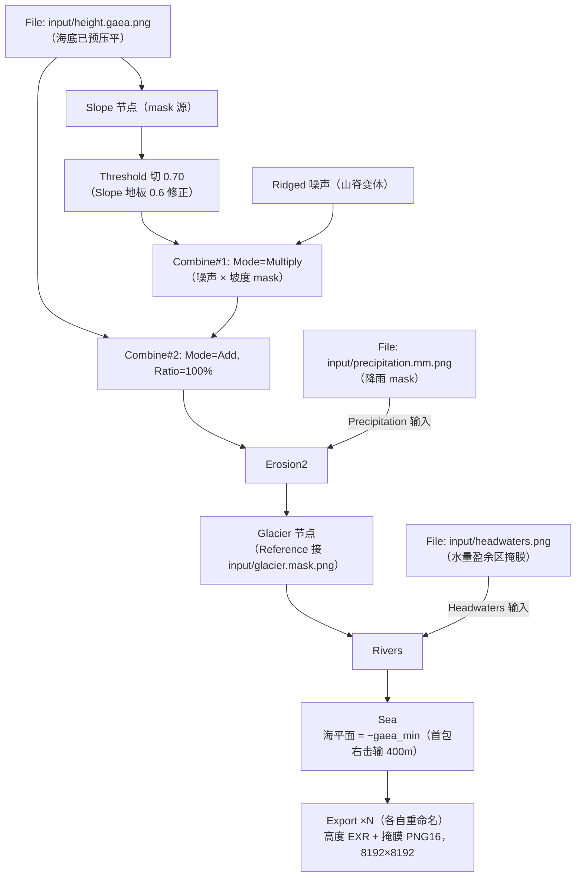

# Gaea 2 视频素材链操作手册和踩坑记录

本文档是卫星影像素材 MVP 第 ② 步的操作配方：把 `export region` 数据包
（pack v4，契约见 [../design/proposals/blender-render-pipeline.md](../design/proposals/blender-render-pipeline.md)）
送进 Gaea 2 做米级侵蚀，导出供第 ③ 步气候权威着色和第 ④ 步 Blender 渲染
使用的 8K 高程与掩膜。GUI 操作细节（按钮位置、节点面板）以 KilroysKartography
「终极写实主义」教程 Part 2（B 站转载 BV15EHR6NEoC，05:28 起）为准；本文只固定
与数据契约相关的参数，保证每次出片可复现。

**pack 根目录布局**（2026-10-11 起）：`input/`（引擎导出通道，File 节点从
这里取 `height.gaea.png` / `precipitation.mm.png` / `headwaters.png`）、
`gaea-out/`（Gaea 构建产物）、`color/`（着色产物）；Gaea 工程文件
（`*.terrain`）放 pack 根。

## 数据包数值还原（每次导出后先读 meta.json）

数据包里的 PNG 都是归一化编码。Gaea 内部把高度场存为 0–1 归一化值，
物理量程由 Terrain Definition 面板定义（2.3.1 实测位置：**Build 页签 →
Build Options → 左侧 Terrain 页**，不是底部的 Terrain 页签），且海拔
不支持负值。

**Gaea 2.3.1 的硬上限（实测）**：Width ≤ 2400 km、Height ≤ 10000 m。
因此导出侧配合两条规则——导出区域 span 取 ≤ 2350 km（像素盒外扩取整后
的实际范围见 `extent_km`，仍在 2400 km 内）；高程用**海底预压平**的
`height.gaea.png`（`--seafloor-clamp`，默认 −400 m：海平面以下全部压到
该深度，深海沟在镜头里不可见，压平后垂直量程才能落进 10 km 上限，
陆地部分保持全 16-bit 精度）。

还原组合（以 nacrea-15_90_2350km 为例，换新区域时从新 meta.json 重算）：

- **Terrain Definition**：Height = `height_gaea_png_range_m` 的
  max − min（首包 = 8787.84 − (−400) = **9188 m**）；Width =
  `extent_km` 的较大值（首包填 **2364460 m**）。此面板定义全项目的
  真实尺度，侵蚀模拟、测量与导出都以它为准——不要用 Adjust/Multiply
  节点替代它做量程还原（数值上虽然等效，但物理模拟会按错误的 TD
  尺度工作）。
- **File 节点导入 `height.gaea.png`，无需设置量程**（2.3.1 实测）：节点
  把 16-bit PNG 归一化到 0..1（Stats 面板可见 Min 0 / Max 1），再乘
  Terrain Definition 的 Height——物理高度 = 内部值 × Height + min，
  精确还原。Crop to Square 开不开都行（v3 输出已是正方形）。
- **海平面偏移**：物理 0 m 在 Gaea 世界单位里是 −min（首包 =
  **400 m**）。Sea 节点按这个值设置；右击滑杆可以直接输入带 `m`
  后缀的数值。
- **降水 mask 无需量程还原**：`precipitation.mm.png` 直接 File 导入即可，
  Gaea 只用它的空间分布作 0–1 乘子，毫米绝对值（量程在
  `climate.precipitation_mm.png_range`）不参与侵蚀计算。

注意数据包是 2048×2048 正方像素（`--out-res` 可调），标量通道
（高程/降水/温度/冰厚/NPP）在 cell 中心的 Delaunay 三角网上
Clough-Tocher C1 插值——cell 中心保真、梯度连续（C1 而非 C0 是侵蚀链的
硬要求：线性插值的梯度在三角边上不连续，折痕是网格伪影而非地质，
Erosion2 会沿折痕刻出虚假沟壑；npp 图与北部深海曾因此出现三角面片）。
插值在
经纬度空间做、输出网格正方形，3.5% 的各向异性也一并消除。类别通道
（Köppen/biome 类别码）保持最近邻。

**「预览看起来很平」是正确的**（2.3.1 实测踩坑）：TD 按真实量程设置后，
8788 m 的高峰在 2364 km 幅宽里高宽比只有 0.4%，视口里就是一片缓坡上
一条浅山弧。默认 TD（几 km 宽、2500 m 高的小世界）下同一数据的「陡峭」
外观是上百倍垂直夸张。侵蚀的坡度与水流功率只在真实标度下物理正确，
**不要为了预览好看而调小 Width 或调大 Height**——想检查形状就用视口
相机贴近看，或临时在图里接一个 Adjust 看形状（导出前拆掉）。
同理，**幅度型节点（如 Ridge Height 0.05）导出的 PNG 目视全黑是正常的**：
值域被 Height 压在底部几个百分点，数据没丢——目视检查用视口预览或
临时 Autolevel，别为此调大 Height。

## 节点配方



逐步说明：

1. **File 导入高程**。选 `height.gaea.png`（16-bit，海底已按
   `--seafloor-clamp` 预压平，无需图内 Clamp 节点），节点本身无需设置
   量程（2.3.1 默认行为即 Raw 语义，见上节），量程还原全部在 Terrain
   Definition 完成。构建分辨率开 8192（Indie 上限 8K，对 4K 成图够用）——注意它与预览分辨率
   是两个设置：视口下拉框的预览分辨率所有版本上限都是 4096，构建分辨率
   在 Build 页 → Build Settings → Resolution 里选。构建是从零按全分辨率
   重算整个图（不是放大预览），细节会比预览更好。输出用 Export 节点
   （见第 7 步），不要用 Mark for Export。
2. **补噪声（本区域实测推荐开启）**。若 8K 构建下山体仍太「光」，在
   Erosion2 **之前**插 ridged 分型噪声：Ridge 节点 **Height 0.15–0.2**
   （注意实测踩坑：山脊尖峰只到达 Height 的 ~20%，0.05 的实际振幅只有
   ~90 m，会被 800 m 级的侵蚀雕刻淹没；0.15–0.2 → 有效振幅 ≈ 280–370 m）、
   Scale 从 0.75
   起按山脊间距 20–50 km 目调、Seed 固定记录；**Combine 用两个：Combine#1
   Mode=Multiply 算 噪声 × 坡度mask，Combine#2 Mode=Add（Ratio 100%）把
   它加回地形**——不要用 Combine 的 Mask 端口（2.3.1 实测踩坑：其「亮区
   =输入1/暗区=输入2」语义拦不住噪声，全域施加导致沿海低地被低频
   swell 抬高 ~36 m、海面缩小 2.7 个百分点；Multiply 语义无歧义，
   平原精确为 0）。两个 Combine 的 Ratio 都 1.00。Output Clamp：
   Combine#1 随意（[0,1]×[0,1] 不越界）；Combine#2 保持开但注意
   一般规则——File 的 Stats Max + 噪声振幅 > 1.0 时 Clamp 会把峰顶
   削成平顶，此时改 None（首包 0.956 + 0.04 安全）。——山脉位置由数据包
   决定，噪声只补中尺度细节。首包实测证据：山区高频能量侵蚀后仅
   1.3×，侧翼呈绒面质感，触发本步。Slope 节点配置（2.3.1）：In 接 File
   高程输出（不接 Combine，避免循环依赖）；Range `2|90`°（平原 <1°、
   山弧侧翼 2–15°，下限 2° 排除平原/洋底）、Falloff 5、Type =
   **Accurate**（Normalized 会把值域拉平，平原会混进 mask）、
   Micro Accent 0。自检：预览 Slope 输出应山弧亮、平原海洋黑。
   **Slope 输出口径踩坑（2.3.1 实测）**：Range [2,90]° + Falloff 5 时输出
   地板是 0.6 而不是 0（平原是灰色不是黑），直接当 mask 会让噪声漏进
   平原（实测平原被抬 ~67 m、海面缩小数个百分点）。修法：Slope 后串一个
   **Threshold 节点切 0.70**（山弧留 1、平原归零），再把阈值后的 mask
   送进 Multiply。验证：Multiply 预览里平原应真正全黑。
3. **Erosion2 主侵蚀**。按 gaea-refinement.md §6 第 2 步的口径：目的不是
   重塑山脉位置，而是把上采样后的平滑地形雕刻出自然山脊与河谷。
   大陆尺度的起始参数（2.3.1 实测调定，两千公里级幅宽）：**Erosion
   Scale 20000**（侵蚀特征的整体尺寸，2.3.1 上限 20000 m——默认 1000 m
   在此尺度下是亚像素细沟：4K 预览 577 m/px、8K 成品 289 m/px；更大的
   特征靠 Duration/Downcutting 累积）、**Downcutting 0.5–0.7**（下切是
   刻出河谷的主力，默认 0.3 偏保守）、Duration 4–8。降雨输入接第二个
   File 节点导入的 `precipitation.mm.png`——这是引擎气候场驱动的非均匀
   降雨，是整条链区别于默认均匀降雨的核心卖点。若降雨效果太弱或太强，
   先调 Erosion2 的降雨缩放，不要改 PNG 本身。**验证看 Flow 输出而不是
   高程预览**：点击 Erosion2 节点右侧 Out/Flow/Wear/Deposits 端口的小
   圆点切换预览对象；河网是累积流量图，预览里直接可见——从山弧向海洋
   汇聚的树状网 = 尺度正确（顺带验证朝向：河流必须流向海洋）。
   数值直接输入：点击拉条上的数字本身即变为文本框；右击拉杆可带单位
   输入（如 `20000m`）。
4. **Glacier 冰川侵蚀（冰盖区）**。Erosion2 之后接 Glacier 节点，**Reference
   输入**接 `input/glacier.mask.png` 的 File 节点（= 冰厚>0 ∪ 群系ice
   双源掩膜；nacrea 本区冰厚全 0、靠 EF/群系ice 的 120 cell 冰盖——
   ice.m.png 全黑是真实状态不是 bug）——冰川只长在引擎算出的冰盖上
   （厚度 >0 处），在冰盖边缘刻出 U 形谷/冰斗，让河口深切这类地貌获得
   合法的冰川成因解释。起始参数：Thickness 中低（本区冰盖中等厚度）、
   Scale 默认、Breakage 默认；预览验证冰川只出现在冰盖区、不漫到
   无冰山地。**Glacier 内存大易爆**：换 **Hybrid Build**（内部瓦片化再拼合，
   内存友好）——Standard Build 是全地形一次性算（8K 下官方口径 50 GB+
   常见）；Tiled 拼接不减内存（Indie 的 Split to Tiles 同理）。
   **Hybrid 启用条件（官方 Build Types 帖 + 2.3.1 实测）**：Build
   Definition 里 Subdivision（Faster/Balanced/Slower）灰色不可选 = 前提
   未满足，两个硬性前提——① File 等生成器节点全部右键 **Bake**（未
   Bake 的输入节点会锁住 subdivision 选项）；② 工程已保存到磁盘。
   满足后 Subdivision 解锁，选 Balanced（质量/内存折中）。官方一线排查：
   保存工程 → 删 build cache → 重建。
5. **Rivers 产河网掩膜**。接 Glacier 之后（In 接 Glacier 的 Out——2.3.1 实测踩坑：误接 Flow 端口会让输出高程被压到百分之几，
   地形「神秘被压扁」先查接线）。**Headwaters 输入接数据包的
   `headwaters.png`**（水量盈余区掩膜：陆地且 P > Hamon PET，引擎物理
   现成）——Rivers 是纯坡度驱动（官方原话"whether it can sustain rivers
   or not"），不接河源约束就会在沙漠平地发源常年大河；接了之后沙漠里
   只剩从湿润区流来的过境河（尼罗河模式）。注意 Erosion2 的降雨 mask
   保持用 P（不扣蒸发）——暴雨径流是干旱区侵蚀的真实主力，两个输入的
   物理口径不同是有意的。导出 Rivers（掩膜）与 Depth（水深，
   供 Blender 河水调制）；Out 若开了下切则取代 Erosion2 的 Out 成为最终
   地形（它含连通性微调，永不回流引擎）。Surface / Direction 不导出
   （水面在 Blender 自建；流向只有 flow-map 动画才用）。**已知限制**：
   Rivers 会为连通性微调地形，内流盆地（本库湖泊多属此类）不被尊重，
   河总是流到海——表现层限制，不修。**河口深水溺谷归因（2.3.1 实测 +
   No-Erosion 消融 + 参数消融矩阵）**：开关是 Rivers 的 **Water 量**
   （0.03 无 / 0.04 有），但诱因是 headwaters 掩膜——无掩膜时水源分散、
   河多而小（1.10% 覆盖），Water 1.00 也挖不穿基准面；掩膜集中供水到
   盈余区（含内陆湖）后，Rivers 为保连通把湖区到海的通道挖到海下
   （实测 −316 m、深入 ~530 km）。Depth/Width/Downcutting/Headwaters
   数量对此都无影响（用户消融矩阵）；Downcutting 0.75 会在入海口挖出
   宽阔海湾。想收河口：降 Rivers 的 Water（≤0.03），或接受为沉溺
   低地地貌（长江口/亚马逊式）。**沿海狭长海湾/内陆小湖归因（对照区消融实锤 +
   插值对照实验定案）**：伪影源头是导出端 Clough-Tocher C1 插值的
   **下溢**——海岸陆 cell（+10 m 级）紧邻深渊 cell（−10 000 m 级）时，
   三次曲面在陆侧挖出海平面以下的假盆地（对照区 C1 插值产生 45103 px
   封闭水下盆地，换线性插值只剩 1501 px；旧图可见海岸隆起+内侧凹陷的
   振铃纹），Sea 一淹即成近岸假湖/假湾。**当前实现**：插值结果
   裁剪到所在三角形顶点的值域（与线性/自然邻域插值同等的局部有界保证），
   对照区伪湖降至 8069 px（残余均为触及真负值 cell 的三角形），梯度
   平滑度与 C1 持平、cell 中心值不变。修复对全部标量通道同时生效（共用
   同一插值函数）：降水通道旧算法同样越界（最大 −975 mm 假干旱/
   +672 mm 假暴雨，~15–20% 像素被裁剪），NPP 次之（±1000 gC/m²/yr 级），
   温度很小（±1.9 °C）；类别通道（Köppen/群系）走最近邻、掩膜走派生
   规则，本来无插值越界，但 headwaters 掩膜间接依赖 P/T/高程插值，
   沿海判定随之修正。自然邻域插值（GIS 界有界平滑的
   标准选项）经 MetPy 实测 512² 都超过 5 分钟，2048² 不可用，否证。
   首包（15°N 90°E）残留的 38277 px 封闭水下区全部对应引擎里真实的
   负高程陆 cell 内流盆地（距海 ~590 km，中值 −31.5 m），不是伪影。
   **Sea 的 Water 端口就是二值掩膜**（1-bit PNG）。曾因接线错误把 Export
   接到别的高度场端口，导出「海面高程图」误诊为 Water 不是掩膜——
   数据看起来不对时先查接线端口名。**河网密度调节**：接了 headwaters
   掩膜后河网变稀是正确结果（首包 1.10% → 0.20%）；要加密调 Rivers 的
   Headwaters（源头数量）与 Water（源头水量），不要拆掩膜。注意
   Headwaters 大步加码会让 Rivers 构建失败（2.3.1 实测 500 即失败，
   疑似内存），小步试（150 → 300）。
6. **Sea 定海平面**：物理 0 m = Gaea 世界单位 −min（首包 400 m）。Sea 节点
   的 Level 在 2.3.1 里是分位数拉杆（0..1），**右击拉杆输入 `400m`**，
   Gaea 按 Terrain Definition 自动换算（首包 = 400/9188 ≈ 0.0435）；
   手算输入 0.0435 亦可。所有百分比类参数都支持这种带单位输入。
   **Shore Size / Shore Height / Variation 全部设 0**——这三个是 Sea 的
   海岸侵蚀功能（人造海滩/悬崖），我们的海岸线已由引擎 + Erosion2 决定，
   不需要二次雕刻；我们只要 Sea 的海平面与 Water/Depth 掩膜。
   Sea/Global 下拉选 **Global**（全局水面，与引擎「低于 0 m 即海」一致）；
   Sea 的 Out 不导出（最终地形用 Rivers 的 Out），只导 Water / Depth
   掩膜（PNG 16）。
7. **导出**。Export 节点（Output 族）只在 **Execute Build** 时才写文件，
   预览不落盘（2.3.1 实测踩坑：建好 Export 节点找不到文件 = 还没构建）。
   落盘位置由节点 Location 设置：Build Folder = Build Settings → Build 页的
   Build Destination（默认 `<Documents>\Gaea\Builds\<项目名>\###` 自增）；
   建议改成 Explicit 直接指到 pack 根的 `gaea-out/` 子目录
   （`private/video/` 整体不入 git）。格式：**只有主地形（Out）导 32-bit
   EXR**——它是 Blender 位移的数据源，需要浮点保真；**所有掩膜一律
   PNG 16**（Erosion2 的 Flow/Wear/Deposits、Rivers 的 Rivers/Depth、
   Sea 的 Water/Depth），16-bit 的 65536 级对掩膜绰绰有余。
   EXR 存的是 Gaea 内部 0..1
   归一化值（2.3.1 实测，单通道 Y），物理米值 = v × Height + min
   （首包 = v × 9188 − 400），Blender 侧按此换算。
   **喂给 Gaea 的 mask 必须 16-bit**（2.3.1 实测踩坑）：8-bit 位图会被
   误读成「右上四分之一 + 黑白反转」（0xFF 落到 255/65535 ≈ 黑）——
   headwaters.png / glacier.mask.png 均按 16-bit 导出。
   全部在 8192 构建分辨率下出（Build Settings → Resolution）。
   注意 Export 节点与「右键 Mark for Export（F3）」是两套导出机制
   （后者由 Build Settings → Nodes 页管理），选一套用，别重复导出。
   **每个 Export 节点建好后立刻重命名**（右键 → Rename 或 F2，如
   `exp-height` / `exp-flow`）：导出文件名取自节点名，多个同名 Export
   节点的产物会互相覆盖（2.3.1 实测踩坑）。
   **构建后验收先看时间戳再看报告**（2.3.1 实测踩坑）：构建失败的节点
   不会写文件，目录里留下的是上次构建的旧产物——`report.json` 的
   "Success" 不可信，真实状态看 `report.txt` 的失败列表
   （`节点 - failed!`），或直接用文件时间戳确认全部导出都刷新了。
   节点失败会连坐：Rivers 挂了，下游 Sea 与其全部导出、乃至上游
   Erosion2 的导出都会中断，只有独立分支（如 Ridge）能写出。

## 回到管线的接口

Gaea 的输出不回流引擎（地形 bake 往返协议是另一条待办线）；它的消费方是：

- 第 ③ 步着色：`dreamulator export render --style satellite <pack 目录>`——见下节。
- 第 ④ 步 Blender：EXR 高度做位移，着色贴图做 albedo，flow 掩膜辅助
  河流/水面材质。

**掩膜数值天然集中在值域底部**（2.3.1 实测）：Flow/Wear/Deposits 的 99%
像素 ≤ 0.5%–2% 亮度（流量是重尾分布，大河占了绝大部分水量），直接看图
是黑的，属正常。下游消费时按分位数截断归一（如 p99 → 1.0）；Gaea 侧想
肉眼检查就接一个 Modify → Autolevel 节点，不要改原始导出。
另外 Sea/Rivers 的二值掩膜导的是 1-bit PNG、深度图用高度场单位
（× TD Height = 米），消费时注意类型。

## 第③步：气候权威着色（satellite_color）

```bash
uv sync --extra media        # 首次需要（OpenEXR 读 Gaea 的高度 EXR）
dreamulator export render --style satellite private/video/nacrea-15_90_2350km
# 读 <pack>/gaea-out/，写 <pack>/color/{albedo.png, preview.png}
```

实现 = `src/dreamulator/media/satellite_color.py`。口径：基色由引擎群系
驱动（`biome.codes.npy` 最近邻上采样到 Gaea 网格），再用两层手法消除
cell 痕迹——**域扭曲**（fBm 噪声扰动采样坐标，真实幅度 0.5 cell、波长
1.5 cell，把笔直的 Voronoi 边界弯成有机生态过渡带；类别归属不变，
气候权威性保留——类别标签不可插值，扭曲是类别场的标准做法。**实测
踩坑**：opensimplex 原始值域约 ±0.7 且 fBm 八度叠加会进一步压缩幅度，
不归一化到 [−1,1] 的话标称 0.35 cell 的扭曲实际只位移 p90 23 px
（1/8 cell），多边形依旧明显——`_fbm_field` 里按实测峰值归一后
幅度才到位）和
**NPP 连续调制**（引擎 Miami NPP 按群系内中位数归一后调明暗 ±22%，
同群系内水热好的谷地更浓绿——真实遥感颜色就是这么工作的）。
**水陆口径裁决（重要）**：渲染水面只认 Gaea 的 sea 掩膜（与 Blender 位移的
地形天然一致）——引擎海洋 cell 被插值/侵蚀抬到水线以上时（首包有 ~3%），
不得按海洋深蓝上色，而是用最近的陆地群系色填充（用户实测发现的沿海
深蓝块即此问题）。湖泊是淡水浅色 + 距离变换伪水深，不用海洋深蓝
（深湖蓝在视觉上会被读成海）。Gaea
掩膜只做质感调制（坡度→裸岩、wear→侵蚀痕、deposits→冲积土、河道/
海洋按深度分色、冰厚→冰川白）。albedo 不烘焙光照（打光是 Blender 的
事），preview 叠了软 hillshade 仅供肉眼快检。色表与调制权重全是模块
顶部常量（标注为制图选择），调色直接改常量重跑。扭曲幅度按 meta 的
`cell_pitch_km` 自适应网格密度。

**着色器调参表**（全是 `satellite_color.py` 顶部常量，改后重跑
`export render --style satellite` 即可，无需动 Gaea）：

| 常量 | 当前值 | 作用 |
|------|--------|------|
| `WARP_AMPLITUDE_CELLS` | 0.65 | 域扭曲幅度（cell 倍数），边界蜿蜒程度 |
| `WARP_WAVELENGTH_CELLS` | 1.5 | 扭曲波长（cell 倍数），弯曲的疏密 |
| `BIOME_BLUR_SIGMA_PX` | 20 | 群系色调过渡带宽（8K 下 ≈ px×1.15 km） |
| `ICE_BLUR_SIGMA_PX` | 4 | 冰盖边缘软化 |
| `NPP_MOD_STRENGTH` | 0.22 | 群系内明暗调制强度（±22%） |
| `ROCK_SLOPE_LO/HI`、`ROCK_MAX_WEIGHT` | 0.35/0.6/0.70 | 裸岩出露的坡度窗与最大权重 |
| `WEAR_MAX_WEIGHT` / `DEPOSIT_MAX_WEIGHT` | 0.25/0.30 | 侵蚀痕/冲积色调制上限 |
| `SEA_DEEP_M` / `RIVER_DEEP_M` | 400/8 | 海/河水深颜色渐变的参照深度 |
| `BIOME_COLORS` / `LAKE_*` 等色表 | 见源码 | 各群系基色（卫星影像风，制图选择） |

**已知限制（2026-10-11 登记，后续想办法）**：扭曲+模糊只能把边界做到
「cell 边长量级的精细度」——cell 内部的颜色变化上限是 NPP 调制提供的
平滑场，无法长出 cell 内的真实细碎纹理（如河湖支流的植被镶嵌）。想再
进一步需要在 cell 内引入地形/水文驱动的次网格细节（如按 flow 掩膜和
坡度做植被密度调制），或等更高分辨率网格。

每次换区域重新出片时，只有「量程还原」一节的数值会变（从新的 meta.json
读），节点配方不变。**换区必改三件套**（2.3.1 实测踩坑：沿用旧包的
Level 分位数导致海平面偏低 6 m）：TD 的 Height（= 新包
`height_gaea_png_range_m` 的差值）与 Width（= `extent_km` 较大值）、
Sea 的 Level（右击输 `400m` 最稳，或手算 −min/Height）。

## 第④步：Blender 渲染（region_still）

```bash
"/d/Blender 5.2/blender.exe" -b -P scripts/media/blender/region_still.py -- \
    --datadir private/video/nacrea-15_-100_2350km \
    --render still_4k.png --res 3840x2160 --samples 256
# 写 <pack>/renders/*.png + <pack>/scene.blend（可随时由脚本重建）
```

实现 = `scripts/media/blender/region_still.py`。地形默认取
**Gaea 侵蚀后高度场**（`gaea-out/rivers-h.exr`，回退 `erosion2-h.exr`；
`--terrain input` 用引擎原始高度）。8K EXR 盒采样降到 `--mesh-res`
（默认 2048² = 420 万顶点）。**EXR 换算已实测定版**：值 ×
`height_gaea_png_range_m` 差值 + min，**原序**直接对齐（与 16-bit PNG
孪生对照 corr 0.997；翻转则崩到 0.19——EXR dataWindow 行序与 PIL 一致，
但 Blender `img.pixels` 是自底向上，脚本内已翻转）。场景单位 1 unit =
1 km，物理垂直比例（`--zscale` 夸张化）。贴图用 `color/albedo.png`
（色彩权威，回退 `input/color.png`）。Cycles OptiX，4K 256 samples 实测
40 s。

**踩坑（5.2 LTS 实测）**：
1. **曝光链是 LDR 色彩权威管线，太阳强度是标定值不是物理值**——
   albedo.png 是参照色，视图变换用 Standard（无高光滚降），漫反射
   L ≈ albedo·E·cosθ/π 要落在 [0,1]：sun energy = 6 W/m²。常见错法：
   用 Blender 默认新场景的 1000（≈太阳常数，物理正确但那是配 AgX
   HDR 视图用的——Standard 下漫反射 ≈76 线性值，整图纯白；AgX 下
   也过肩泛白）；写成 3 则偏暗。**验收必须用 PIL 统计**（mean
   90–160、p99 <250），不能目视——图像查看器（含 AI 读图工具）
   会自动拉对比度，过曝白图看着像正常的。
2. **海面 roughness 0.35**——镜面海面在掠射太阳角下出条纹噪声，
   卫星视角水本来就不是镜面。
3. 4.2M 面网格 + subsurf 每级 ×16 面，6 GB 显存下 subsurf 默认关
   （`--subsurf` 开）。
4. Blender 自带 Python 无 OpenEXR 模块，读 EXR 走 `bpy.data.images.load`
   原生路径。

当前镜头：全景高斜视（slant 1.5× extent、25° 仰角、35 mm、太阳
东南 35° 暖光）。后续：低空掠海镜头、大气透视、河流水面、夜景城市
灯光（文明层）、相机动画（视频成品主线）。

## 第③'步（变体腿）：制图（export render --style survey|hand|medieval）

与第④步 Blender 平行的另一条渲染腿，共用 ①② 的产物（pack + Gaea
构建）。**一个命令三种风格**（10-13 用户裁决收敛 CLI：medieval 不做
子命令，作风格参数；`--title` 可自定义标题）：

```bash
dreamulator export render --style survey private/video/nacrea-15_-100_2350km              # survey
dreamulator export render <pack> --style hand                              # topo.hand.png
dreamulator export render <pack> --style medieval --title "珠母星 · 海"
# 读 <pack>/input + <pack>/gaea-out，写 <pack>/carto/
```

**survey（近代测绘风，默认）** = `carto_render.py`（复用 satellite_color
的 `load_inputs`/`hillshade`）。要素：分层设色 × hillshade
（HILLSHADE_STRENGTH 0.45——小比例尺全景图上浮雕只做暗示）、两级等高线
（500 m 首曲线细线 / 1000 m 计曲线粗线；**等高距按图幅比例尺定**——
2364 km 幅面 ≈ 1:1000 万，250 m 间隔会糊成网）、**自适应经纬网**
（GRATICULE_STEPS_DEG 从 1° 起选让 3–8 条线过图，虚线 + 边缘度数
标注；像素↔经纬换算用 meta 中心 + 等距圆柱近似）、海部平色、河流
三级线宽、高程色阶图例/比例尺/指北针/图名。色表与等高距全是模块顶部
常量（制图选择）。出 **SVG 矢量 + 300 DPI PNG**。

**hand（旧印刷质感，视频素材腿）** = survey 叠印刷/材料伪影
（`--style hand` → `topo.hand.png`）——①纸纹 multiply + 等高线顶点
低频抖动（PAPER_TEXTURE_*/WOBBLE_* 常量；抖动幅度 ≪ 等高线平距，
形态不损失）；②**水彩晕**（色带 σ1.6 px 软化，笔刷渗色感）；
③**套色偏移**（色 plate 相对墨线漂 1.2 px，红蓝反向——旧印刷套版
不准）；④**墨线重描**（等高线按弧长切 14 px 段，LineCollection 逐段
线宽 × 低频噪声调制，原均匀线隐去；**按连通环切分**——QuadContourSet
把同级不连通环打包进单 Path，连续折线假设会画出跨图直线）；
⑤**楷体注记**（KaiTi 字体栈）；⑥**边角磨白**（角落 vignette 向纸色
收敛）。全部是
印刷/材料层伪影，叠在色彩权威之上、不改地形语义。政区与 conlang
注记按用户裁决移出本分支（下一层级）。图名用天体英文名（「Nacrea ——
15°N 100°W 附近」格式，`planet_display_name` 从 system_catalog.yaml
的「中文名 · English」取英文部分；mpl 需设 CJK 字体栈——图例注记是
中文）。**色阶单一事实源（10-13 用户裁决）**：分层设色与前端 terrain
模式共用 `palettes.json` 的 `adaptive_terrain`（ETOPO 海 + Natural
Earth 陆），`_lut_rgb` 查表上色；**查表值域用未 clamp 的引擎值域**
（meta `height_png_range_m`）——Gaea 高度场海底压平在 −400 m，深海
渐变（min 锚 fraction 停靠点）在 clamp 值域上会错位到陆地高程，海部
改经 sea-depth 通道查同一 LUT。
图例形态（真实图样例调研定版）：竖直色阶条（刻度在右——横排 4 位
数字挤在一起）、**整数分档**（LEGEND_LADDER_M 制图惯例值，只列
本图幅实际出现的档——图例不列图内未出现的值，palette 内部锚定
分数值如 460/1660 不直接示人）、档色 = 共享 LUT 在该档下边界的
采样（单一事实源保持）、图下无文字注记（10-13 用户裁决：等高距
说明行删除，左下只留高程色阶）。**等高线 inline 高程标注默认关**
（`--contour-labels` 开启）——全景小比例尺下线上数字偏噪。指北针
= N + 半黑菱形头。

**与真实测绘图的差距清单（10-13 自查，后续优化方向）**：

1. **色带边界与等高线对齐**——真实图分层设色边界即等高线位置；
   当前色带是连续 LUT、等高线是 500/1000 ladder，非一一对应。
   对齐后色带边界会被粗线强调，读图感立刻「真」。
2. **海岸线符号**——真实图海岸线是独立深色粗线，当前只是色带边界。
   加 sea 掩膜轮廓线（~0.8 pt 深蓝）即可。
3. ~~经纬网~~ ✅ 已实现（自适应步长 + 边缘度数标注）。图廓分度带
   可再进阶。
4. **间曲线**——真实图陡坡区用半距虚线加密。可选。
5. **植被/沼泽面状符号**、**高程点注记**（山峰▲+高程）——纯增量
   制图要素。
6. **印刷质感**——✅ hand 风格已做（水彩晕/套色偏移/墨线重描/磨白）。
7. 注记排版（山名/地名分级与避让）= 二阶段裁决移出本分支。

## 第③''步（变体腿）：中世纪羊皮纸插画图（medieval_render）

```bash
dreamulator export render --style survey private/video/nacrea-15_-100_2350km --style medieval
# 读 <pack>/input + <pack>/gaea-out，写 <pack>/carto/medieval.png
```

实现 = `src/dreamulator/media/medieval_render.py`（与 carto_render 只共
享 load_inputs 数据层，渲染传统完全不同——CK/韦诺之风）。**无图例、
无等高线、无比例尺**：地形用符号说话——山峰群（高程>1200 m 且坡度
前 45% 的 jitter 网格采样，尖峰 + 东侧影线，高越高峰越大）、树群
（森林群系 mode-pool 采样，圆冠+干）、粗河流（深度掩膜 0.12 级
contour，示意主干）、海岸墨线；羊皮纸底（斑驳 + 噪声破缺烧焦边）、
海部淡靛 wash（共享 LUT 经真实 depth 通道查表 ×35% paint load）、
图内正上方酒红绶带标题（金边燕尾）、十六角罗盘玫瑰、双线框角饰。
符号间距刻意疏朗（MOUNTAIN_GRID_PX 36 / TREE_GRID_PX 32）——插画读
作「群」而非壁纸。近代测绘风格保留于 carto_render（后续优化）。
**画风自评未达 CK 水准（10-13 用户裁决：暂搁置，之后调研作图方法
再迭代）**。

**风格参考库（private/video/reference/styles/，Wikimedia 公共领域）**：
中世纪 = Catalan Atlas 1375 / Tabula Rogeriana 1154 / Hereford
Mappa Mundi 1300；近代铜版测绘 = Dufour 1865；现代标准等高线 =
USGS 1:24000 quad 1959 / 瑞士 Landeskarte 1975。CK3/韦诺为商业
作品不可下载，中世纪风以古地图三张为对标。

## 待查项

- **carto 等高线蜿蜒不足 + 河流网状**（10-13 用户观察，换可编程侵蚀后修）：
  等高线相比真实图/手绘图蜿蜒度低（细节不足）；河流呈网状分岔而非
  树状（向下游分岔异常多——正常河网只在上游分岔，下游汇流）。两者
  都是 Gaea 侵蚀参数所致（河网网状疑与 Water 量大 + Downcutting 0 的
  组合有关），不在 Gaea 链内继续调参——SPL 可编程侵蚀路线上线后用
  物理正确的河流袭夺/汇流结构解决。
- **湖泊在 Gaea 链中的命运**（2026-10-11 登记，暂不优先）：数据包的湖格
  （biome=lake）在侵蚀地形里是盆地还是已被 Rivers/Erosion2 排干抹平？
  着色器目前按引擎群系把湖画成水体（距离变换伪水深），如果 Gaea 地形里
  湖盆已被沉积填平，Blender 成图会出现「干地上的水色」。需要拿
  rivers-h.exr 对照引擎湖位逐湖核查，再决定是给 Sea/Lakes 节点补湖泊
  层级，还是着色侧只画引擎确认有水的湖。
