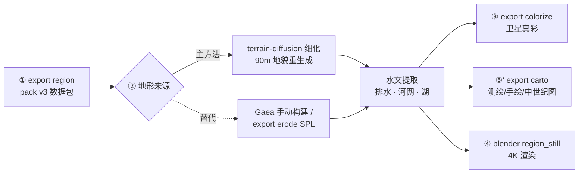

# 地形视频链（terrain-chain）

从世界数据到高清地图/视频素材的主链。地形细节由 terrain-diffusion
模型生成（90 m 地貌），水系由本库的排水算法提取（树状河网 + 内流湖），
渲染支持输出制图与 Blender 素材。**Gaea 2 手动 GUI 构建是本链第②步的
手动替代**（见 [gaea-video-chain.md](gaea-video-chain.md)）；引擎 DEM
的 SPL 程序化侵蚀（`export erode`）是另一个替代，见 cli.md 与
[knowledge/cartography/](../knowledge/cartography/README.md)。

## 准备

### 依赖（三层）

1. **主库核心**（region 导出、侵蚀与水文计算）：随项目安装自带，
   无需额外步骤；
2. **渲染支持**（colorize / carto）：
   ```bash
   uv sync --extra terrain     # OpenEXR + matplotlib（terrain 是链路别名 extra）
   ```
   注意裸 `--extra` 会卸载其他 extras 的包——开发者请用
   `uv sync --all-extras` 或 `--extra dev --extra terrain` 组合。
3. **terrain-diffusion**（第②步主方法的外部模型）：独立 venv，不入
   本项目依赖——它带 3 GB CUDA torch，进 pyproject 会拖累所有环境。
   一次性安装（克隆、CUDA 轮子直连、权重拉取）见
   [knowledge/cartography/terrain_diffusion.md](../knowledge/cartography/terrain_diffusion.md)
   的「工程形态」一节；装好后 `export refine --td <克隆路径>` 即用；
4. **Blender**（第④步渲染支持）：本机安装 Blender 5.x，命令行可执行。

### 前置数据

第①步的 pack 从世界的**构建产物**切窗，所以目标世界必须先构建过：

```bash
dreamulator build nacrea       # geological + climate 两层
```

构建产出 `maps/<planet>/cvt_mesh.msgpack.gz`（地形合成网格）与
`climate_monthly.msgpack`（月度气候序列，第②步的条件场与河道权重都
读它）。世界构建过一次后链路各步可反复重跑，互不依赖重新构建。

## 链路总览



## ① dreamulator export region（共用）

```bash
dreamulator export region nacrea --lat 15 --lon -100 --span-km 550 \
    -o private/video/nacrea-15_-100_550km
```

从世界数据切出方形窗口数据包（`<pack>/input/`）：高程、气候通道
（降水/温度/冰厚/NPP/Köppen/群系）、`meta.json`（窗口与量程契约）。
窗口数学与通道语义见
[design/proposals/blender-render-pipeline.md](../design/proposals/blender-render-pipeline.md)
的契约一节。

## ② terrain-diffusion 细化（主方法）

```bash
dreamulator export refine private/video/nacrea-15_-100_550km \
    --td private/external-projects/terrain-diffusion
```

地形由 terrain-diffusion 模型从引擎粗条件场**重新生成**——90 m 地貌
细节（山脊碎部、谷地起伏）是模型的产物，平原实测细节起伏 σ 31 m。
模型的工作机制、能力边界（确定性、海岸线漂移、不管水文）见
[knowledge/cartography/terrain_diffusion.md](../knowledge/cartography/terrain_diffusion.md)。

命令编排三段：条件场导出（主库，读 mesh 与月度气候）→ td venv 子
进程（条件 GeoTIFF + 扩散推理，550 km 约 2.5 分钟）→ 水文提取（主库）。
条件导出时对全部通道做**海岸域扭曲**（复用渲染链的 boundary warp）：
引擎海陆边界是平直的 Voronoi 边，而 TD 把海岸线锚定在条件的粗格
（23 km）形态上——不扭曲的话 0 m 等值线会是大段直线（实测曲折度
9.1 vs 等高线 10.5），扭曲后 14.6 反超（2026-10-14 实验）。
输出写 `<pack>/refined-out/`（词汇见「输出契约」）。550 km 是单次
推理的实用上限，更大的窗分块跑或后台长任务。**可复现性**：模型无
固有随机性（噪声全由 seed 决定），同 pack + 同 seed 重跑逐位一致
（实测两次全等）；条件场变一点（如窗口切法不同）则会得到另一张
同统计特征的地形——条件生成模型的本质。

## ③ 水文语义（第②步产出，供渲染使用）

- **排水**：Priority-Flood（Barnes et al. 2014 + ε）从海向内陆涨水，
  图边界 = 流出域（陆锁窗也能排水、河流可流出画框）；
- **湖**：填平深度 > 5 m 且连通面积 ≥ 64 格的封闭盆地 = 内流湖
  （fill 面 = 湖面）。TD 生成场 12–13.7% 陆地是封闭盆地（系统性
  水文封闭），湖的数量/面积过程控制在研（见差距清单）；
- **河链**：河源沿 receiver 聚合，遇湖即止、湖溢口续流；共线压缩
  后 Chaikin 切角平滑；线宽按流量 √ 律分级 0.25–1.4 pt（0.09–0.49
  mm，Natural Earth 惯例区间）。语义细节与踩坑实录见
  [knowledge/cartography/drainage_cartography.md](../knowledge/cartography/drainage_cartography.md)。

## 输出契约（refined-out/，与 prog-out/gaea-out 同词汇）

| 文件 | 说明 |
|------|------|
| `height.meters.npy` | 高度 f32 米（pack 网格的整数倍） |
| `height.gaea.png` | 16-bit 高度孪生（量程在本目录 meta.json） |
| `rivers.line.npy` + `rivers.flow.npy` | 平滑矢量河段 (M, 2, 2) km + 流量 (M,) |
| `rivers.png` | 河道掩膜（8-bit，已排湖） |
| `sea-water.png` / `sea-depth.png` | 海掩膜 / 真实水深 |
| `lake.png` | 内流湖掩膜 |
| `flow-accum.png` | 汇流累积（16-bit 归一，诊断用） |
| `meta.json` | 量程 / 海平面 / 参数记录 |

`satellite_color.load_inputs` 自动识别构建目录：有 `rivers-h.exr` 走
Gaea 8K 路径；有 `height.meters.npy` 走本链路径（缺的掩膜读零）。

## ③'/④ 渲染支持（共用）

```bash
dreamulator export colorize <pack> --gaea <pack>/refined-out   # 卫星真彩（默认带
                                                  # 植被纹理，--no-texture 关闭）
dreamulator export carto <pack> --gaea <pack>/refined-out      # 测绘图（默认无等高线，
                                                                # --contours 开启）
dreamulator export carto <pack> --style biome                  # 群系图（分类平色 +
                                                  # 类图例；不需要构建产物，
                                                  # 无 --gaea 时自动回退
                                                  # refined-out → gaea-out → input/）
dreamulator export carto <pack> --gaea <pack>/refined-out \
    --style hand            # 旧印刷质感 / --style medieval 中世纪
blender -b -P scripts/media/blender/region_still.py -- \
    --datadir <pack> --render still_4k.png --res 3840x2160     # 4K 静帧
```

Blender 腿的地形来源自动检测：`refined-out/`（本链）→ `gaea-out/`（Gaea 链）
→ `input/`（引擎原始场），`--terrain refined|gaea|input` 可强制指定。

群系图（`--style biome`）的色表与前端 biome 图层同一事实源
（palettes.json 的 whittaker 色表），海洋留白、图例只列窗内出现的类；
植被纹理（colorize）按群系参数化 fBm 斑驳（森林细密、荒漠宽场、冰原
微起伏）。两路线的参考依据见
[knowledge/cartography/vegetation_cartography.md](../knowledge/cartography/vegetation_cartography.md)。

渲染细节（色彩权威、三风格制图、Blender 曝光链）见
[gaea-video-chain.md](gaea-video-chain.md) 的第③③'④步——两链的
渲染支持完全共用，该手册的这些章节对本链同样有效。

## 差距清单（随更新维护）

1. **湖数量/面积的过程控制**：当前靠深度 + 面积双阈值；方向 = 沉积/
   切穿过程建模（Lindsay 2016 混合策略可参照）。
2. **erode → refine 串行组合**：SPL 刻蚀后的场喂 TD 条件重采样（23 km）
   会抹掉 1–2 km 宽的河谷——两替代法目前只能二选一；组合需要 TD
   条件分辨率提升或流域形态尺度的侵蚀。
3. **相邻块边界对齐**：跨窗地形/河网接续（业界 tiling/seam 做法）
   待调研。
4. **冰川侵蚀**：Gaea 链有 Glacier 节点对位物，本链未实现。
5. **wear/deposits 掩膜**：侵蚀痕/冲积质感（渲染端目前读零）。
6. **D8 方向离散**：8 方向是折线锯齿的根源（Chaikin 平滑已掩盖；
   彻底消除需 D∞ 流向）。
