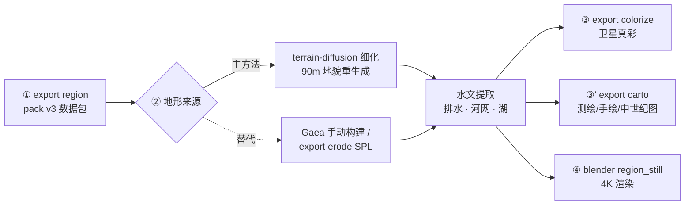

# 地形视频链（terrain-chain）

从世界数据到高清地图/视频素材的主链。地形细节由 terrain-diffusion
模型生成（90 m 地貌），水系由本库的排水算法提取（树状河网 + 内流湖），
渲染支持输出制图与 Blender 素材。**Gaea 2 手动 GUI 构建是本链第②步的
手动替代**（见 [gaea-video-chain.md](gaea-video-chain.md)）；引擎 DEM
的 SPL 程序化侵蚀（`export erode`）是另一个替代，见 cli.md 与
[knowledge/cartography/](../knowledge/cartography/README.md)。

## 准备

### 依赖（三层）

1. **主库核心**（region 导出、侵蚀与水文计算）：随项目安装自带，
   无需额外步骤；
2. **渲染支持**（colorize / carto）：
   ```bash
   uv sync --extra terrain     # OpenEXR + matplotlib（terrain 是链路别名 extra）
   ```
   注意裸 `--extra` 会卸载其他 extras 的包——开发者请用
   `uv sync --all-extras` 或 `--extra dev --extra terrain` 组合。
3. **terrain-diffusion**（第②步主方法的外部模型）：独立 venv，不入
   本项目依赖——它带 3 GB CUDA torch，进 pyproject 会拖累所有环境。
   一次性安装（克隆、CUDA 轮子直连、权重拉取）见
   [knowledge/cartography/terrain_diffusion.md](../knowledge/cartography/terrain_diffusion.md)
   的「工程形态」一节；装好后 `export refine --td <克隆路径>` 即用；
4. **Blender**（第④步渲染支持）：本机安装 Blender 5.x，命令行可执行。

### 前置数据

第①步的 pack 从世界的**构建产物**切窗，所以目标世界必须先构建过：

```bash
dreamulator build nacrea       # geological + climate 两层
```

构建产出 `maps/<planet>/cvt_mesh.msgpack.gz`（地形合成网格）与
`climate_monthly.msgpack`（月度气候序列，第②步的条件场与河道权重都
读它）。世界构建过一次后链路各步可反复重跑，互不依赖重新构建。

## 链路总览



## ① dreamulator export region（共用）

```bash
dreamulator export region nacrea --lat 15 --lon -100 --span-km 550 \
    -o data/worlds/nacrea/packs/nacrea-15_-100_550km

# 气候通道改用 GCM 结果（固定气候分支）：
dreamulator export region nacrea --lat 15 --lon -100 --span-km 550 \
    --branch gcm-t42-712 -o data/worlds/nacrea/packs/nacrea-15_-100_550km
```

从世界数据切出方形窗口数据包（`<pack>/input/`）：高程、气候通道
（降水/温度/年径流/冰厚/NPP/Köppen/群系）、`meta.json`（窗口与量程契约）。
年径流通道（`runoff.mm.npy`）由 Turc–Pike（Budyko，n = 2）年曲线在
年降水对 Hamon 年蒸散上算出，是第②步水文提取的累积权重；世界的
构建产物里没有月度气候序列时不写该通道（水文提取回退到降水权重并
打印提示）。
窗口数学与通道语义见
[design/proposals/blender-render-pipeline.md](../design/proposals/blender-render-pipeline.md)
的契约一节。

**GCM 气候分支导出**：加 `--branch gcm-t42-712`（气候层固定为 ExoPlaSim T42
投影结果的分支，`climate_source: gcm`）时，降水/温度/径流/Köppen/群系全部取
GCM 投影场而非引擎 EBM 模拟。同一窗口在两种气候源之间切换后，**必须做全量
refine**（不能 `--reuse-height`）——TD 推理以温度/降水为条件场，气候源换了，
缓存高度与新条件不再对应。

## ② terrain-diffusion 细化（主方法）

```bash
dreamulator export refine data/worlds/nacrea/packs/nacrea-15_-100_550km \
    --td private/external-projects/terrain-diffusion
```

地形由 terrain-diffusion 模型从引擎粗条件场**重新生成**——90 m 地貌
细节（山脊碎部、谷地起伏）是模型的产物，平原实测细节起伏 σ 31 m。
模型的工作机制、能力边界（确定性、海岸线漂移、不管水文）见
[knowledge/cartography/terrain_diffusion.md](../knowledge/cartography/terrain_diffusion.md)。

命令编排三段：条件场导出（主库，读 mesh 与月度气候）→ td venv 子
进程（条件 GeoTIFF + 扩散推理，550 km 约 2.5 分钟）→ 水文提取（主库）。
条件导出时对全部通道做**海岸域扭曲**（复用渲染链的 boundary warp）：
引擎海陆边界是平直的 Voronoi 边，而 TD 把海岸线锚定在条件的粗格
（23 km）形态上——不扭曲的话 0 m 等值线会是大段直线（实测曲折度
9.1 vs 等高线 10.5），扭曲后 14.6 反超（2026-10-14 实验）。
输出写 `<pack>/refined-out/`（词汇见「输出契约」）。550 km 是单次
推理的实用上限，更大的窗分块跑或后台长任务。**可复现性**：模型无
固有随机性（噪声全由 seed 决定），同 pack + 同 seed 重跑逐位一致
（实测两次全等）；条件场变一点（如窗口切法不同）则会得到另一张
同统计特征的地形——条件生成模型的本质。

**快速重提水文**：`--reuse-height` 跳过 TD 推理，直接用盘上缓存的高度场
重跑水文提取（无需 `--td`）——调湖/河链语义参数时的迭代环（提取一次约
1–2 分钟，全链重跑含推理）。复用优先读 `refined-out/height.pre-equilibrium.npy`
（治愈与平衡水位改写**之前**的场；旧包回退 `height.meters.npy`）：干盐滩
化会把低于海平面的湖床抹平到海平面，从改写后的场无法重新导出湖的
水量收支判据，迭代环必须从原始洼地几何重新推导。heal 与平衡改写对
缓存场都是幂等的。

## ③ 水文语义（第②步产出，供渲染使用）

- **排水**：Priority-Flood（Barnes et al. 2014 + ε）从海向内陆涨水，
  图边界 = 流出域（陆锁窗也能排水、河流可流出画框）。流方向 = 填平面上的
  最陡下降，**平局裁决取淹没前驱**（Barnes +FlowDirs 惯例）：填区内前驱链
  沿 ε 递减直达溢出口，入湖河穿湖心到鞍口而非沿盆缘描边（普通地形上前驱
  从不与真梯度平局，receiver 与纯最陡下降逐格一致）；
- **河网权重（年径流）**：汇流累积按年径流场加权（`runoff.mm.npy`
  通道：Turc–Pike/Budyko 年曲线（n = 2）对年降水与 Hamon 年蒸散；
  月桶因强季节性气候零产流的盲区见
  [knowledge/geology/hydrology.md](../knowledge/geology/hydrology.md) §7）。河网形态因此服从气候：干旱腹地径流趋零、发不出
  河源；穿越荒漠的干流保持入流流量不再增长（外源河型）。权重按陆域
  年均径流归一，`river_threshold` 的单位仍是「上游平均陆格数」，其
  取值规律：精化网格按 factor² 放大保持分辨率不变性；基数 3000 是
  按 Natural Earth 风格图面密度标定的「最小可常画河」；权重按固定
  参考径流 R₀ = 300 mm/yr（地球陆面平均）归一，阈值等价于**绝对**
  最小年平均流量 ≈ 2.1 m³/s，任意窗口同一物理标准（窗口自身均值
  归一会按气候重新计价，荒漠窗曾因此 wadi 蔓生）。
  侵蚀物理仍用降水权重——暴雨径流是干旱区侵蚀的
  主力，两个口径有意不同（Gaea 链时代裁决）。旧包没有该通道时回退到
  降水权重并打印提示，重新 `export region` 即可补上；回退权重带**河源
  门控**（P > Hamon PET 的格才计重，与 Gaea headwaters 掩码同一判据），
  干旱腹地不再凭微弱降水长坡累积发河。物理推导见
  [knowledge/geology/hydrology.md](../knowledge/geology/hydrology.md) §7；
- **内陆水体分类**：`h≤0` 且不与外海连通的水体先分类——小于制图
  MMU（`LAKE_MMU_KM2` ≈ 4.6 km²，精化网格上 256 格；550 km 幅面成图
  约 1 mm²）的按 TD 量化噪声处理（填为海平面陆地，河流穿行续流，
  触边碎点同此），窄于 `LAKE_MIN_WIDTH_KM`（1.5 km ≈ 最宽河线符号的
  1.6 倍）的细长水体按河谷处理（同填为陆地）；达到 MMU 且宽达门槛的
  按内流终点的盐湖/洼地保留（渲湖色，河到岸即止），但距海步桥
  ≤`OCEAN_MERGE_CAUSEWAY_KM`（3 km）的并入海洋渲海色（堤宽两三公里
  的 below-sea 洼地实际就是海——风暴越堤 + nacrea 潮幅直接漫顶；河
  到此即入海）。未做此分类时全图 858 片内陆伪海坑（多 1–6 格）吞掉
  20 条河链、含两条最大干流——「河在平原凭空消失」的直接根因
  （2026-10-16 实证）；
- **湖**：填平深度 > 5 m 且连通面积 ≥ 64 格的封闭盆地 = 内流湖
  （fill 面 = 湖面），但**渲染与断链以 MMU + 最小宽度双门槛**——不达
  的湖不画、河链直线穿过（穿越段成图分辨率下不可见；细长湖无论面
  积多大都接不住比它宽的河线）。湖渲染色与河线同色（测绘图单水色
  惯例）。TD 生成场
  12–13.7% 陆地是封闭盆地（系统性水文封闭），湖的数量/面积过程控制
  在研（见差距清单）；
- **终点湖/过路湖（级联水量收支 + 平衡水位）**：达到渲染门槛的湖
  按**湖图级联**算收支——全部湖先当汇做「首触」累积（每滴水只记
  一次、记给第一个到达的湖；树枝状湖的自重入不会重复计账），再沿
  湖图拓扑序传递 `出流 = 总入流 − 净蒸散需求`（Hamon 年 PET × 0.9 开阔水面
  标定系数 − 湖面降水，按湖面积累计；湿润湖净需求为负、净增水；0.9 为观测
  拟合标定——正确首触路由下大湖收支压在刀刃上，见 CHANGELOG 2026-10-18）。装不满的判
  **终点湖**并改写到平衡水位：湖面缩到收支闭合面积（A* = 入库 ÷
  每格需求，取洼地最深格），出露湖床成陆地；A* 低于渲染 MMU 的
  干化为**盐滩**（整片成陆地，最深处留 1 格不可见汇点终止河网）。
  过路湖照常溢流，但其净蒸散需求从**过流量**中扣除（出湖格负权重）
  ——荒漠湖链不再把全量洪水传下去，165 m³/s 的干流曾凭旧口径冲出
  本应内流的流域。排水全程用改写前的树（终端足印按汇切断）。
  图边界上的湖按过路处理（流域被窗口截断）。缩水湖的入流河沿改写前
  湖底地形的下降树走过干出的湖床、画进新岸一格（干盐滩的河止于滩缘，
  没有可见水可接）。refined-out 的 meta 记
  `terminal_lakes / dry_playas / shrunk_lakes` 三个计数，且每片湖一条
  **`lakes` 记录**（verdict / spill 格与鞍口高程 / 下游湖标 / 入流与
  需求 mm 当量）——溢流与判决数据落盘，不再只活在瞬态数组里。公式、
  教训与近似依据见
  [knowledge/geology/hydrology.md](../knowledge/geology/hydrology.md) §7；
- **河链**：河源沿 receiver 聚合，遇 MMU 级湖即止（终点画进湖岸格
  一格、线触水）、过路湖溢口续流（终点湖不续流）；终点在海/湖/画框
  的短链保留（≥2 点即
  画，丢弃短链会连带整条干流消失）；共线压缩后 Chaikin 切角平滑；
  线宽按流量 √ 律分级 0.25–1.4 pt（0.09–0.49 mm，Natural Earth 惯例
  区间），**逐段流量沿链插值**（宽度向下游渐变，汇合处不再跳变）。
  语义细节与踩坑实录见
  [knowledge/cartography/drainage_cartography.md](../knowledge/cartography/drainage_cartography.md)。
- **月度情相与时令符号**：最终排水树上再做十二次月径流累积。月径流
  由 Manabe 桶与一个线性地下水库共同给出，年总量严格乘回 pack 的
  Turc–Pike 年径流通道，因此基流只改变年内分配。活动月采用独立的
  月均 1 L/s 小流量门槛，不从年度成图门槛推导。河道格十二个月都
  活跃时为常流实线，否则为非常流点划虚线；相邻同类格组成河段，
  不再整链取最干格。月数据不再细分严格的间歇与暂时河。图例只列
  图内实际出现的类别。世界缺月度气候或 pack 缺年径流通道时不做
  分类，所有河保持实线。数学口径、参数不确定性与降级规则见
  [knowledge/geology/hydrology.md](../knowledge/geology/hydrology.md) §7，
  符号依据见
  [knowledge/cartography/river_symbolization.md](../knowledge/cartography/river_symbolization.md)。

## 输出契约（refined-out/，与 prog-out/gaea-out 同词汇）

| 文件 | 说明 |
|------|------|
| `height.meters.npy` | 高度 f32 米（pack 网格的整数倍） |
| `height.gaea.png` | 16-bit 高度孪生（量程在本目录 meta.json） |
| `rivers.line.npy` + `rivers.flow.npy` | 平滑矢量河段 (M, 2, 2) km + 流量 (M,) |
| `rivers.regime.npy` | 逐河段情相 uint8 (M,)：0 常流、1 非常流；缺月度气候或年径流通道时不写 |
| `rivers.png` | 河道掩膜（8-bit，已排湖） |
| `sea-water.png` / `sea-depth.png` | 海掩膜 / 真实水深 |
| `lake.png` | 内流湖掩膜 |
| `flow-accum.png` | 汇流累积（16-bit 归一，诊断用） |
| `meta.json` | 量程 / 海平面 / 参数记录 |

`satellite_color.load_inputs` 自动识别构建目录：有 `rivers-h.exr` 走
Gaea 8K 路径；有 `height.meters.npy` 走本链路径（缺的掩膜读零）。

## ③'/④ 渲染支持（共用）

```bash
dreamulator export colorize <pack> --gaea <pack>/refined-out   # 卫星真彩（默认带
                                                  # 植被纹理，--no-texture 关闭）
dreamulator export carto <pack> --gaea <pack>/refined-out      # 测绘图（默认无等高线，
                                                                # --contours 开启）
dreamulator export carto <pack> --style relief                 # 遥感图（自然色晕渲，
                                                  # 见下；同样自动回退构建目录）
dreamulator export carto <pack> --style biome                  # 群系图（分类平色 +
                                                  # 类图例；不需要构建产物，
                                                  # 无 --gaea 时自动回退
                                                  # refined-out → gaea-out → input/）
dreamulator export carto <pack> --gaea <pack>/refined-out \
    --style hand            # 旧印刷质感 / --style medieval 中世纪
blender -b -P scripts/media/blender/region_still.py -- \
    --datadir <pack> --render still_4k.png --res 3840x2160     # 4K 静帧
```

所有制图风格默认只写 PNG；`--svg` 才附带矢量版（单张十几 MB，无消费方）。
默认标题按风格命名（地形图 / 遥感图 / 群系图 / 古地图 + 中心经纬度），
`--title` 覆盖。`--style relief` 可加 `--biome-legend` 把群系色标并入
河流情相图例（单框）。

Blender 腿的地形来源自动检测：`refined-out/`（本链）→ `gaea-out/`（Gaea 链）
→ `input/`（引擎原始场），`--terrain refined|gaea|input` 可强制指定。

群系图（`--style biome`）的色表与前端 biome 图层同一事实源
（palettes.json 的 whittaker 色表），海洋留白、图例只列窗内出现的类；
植被纹理（colorize）按群系参数化 fBm 斑驳（森林细密、荒漠宽场、冰原
微起伏）。两路线的参考依据见
[knowledge/cartography/vegetation_cartography.md](../knowledge/cartography/vegetation_cartography.md)。

遥感图（`--style relief`，`relief_render.py`）以 NASA Blue Marble NG
地形/水深版为参照：陆面色相完全来自引擎群系分类（经卫星合成器的边界
变形 + 生态过渡带模糊 + NPP 明度调制，过渡带宽约 0.2 个气候细胞），
高程不着色、地形只以双尺度晕渲呈现（在全分辨率网格上乘入后再降采样，
保住沙丘级细部；明暗围绕 1.0 摆动而非纯乘性压暗），海洋为水深渐变蓝；
纹理噪声按 0.35 增益压低（全幅 fBm 斑驳实测大于晕渲信号本身，会淹没
地形）。

渲染细节（色彩权威、三风格制图、Blender 曝光链）见
[gaea-video-chain.md](gaea-video-chain.md) 的第③③'④步——两链的
渲染支持完全共用，该手册的这些章节对本链同样有效。

## QA 循环：`/packs` 子地图页（前端）

验收渲染结果时不必再手算 km↔经纬度：启动 `dreamulator serve` 后打开
前端的「子地图」页（路由 `/packs`，仅本地 API 模式可用——区域包是
世界数据目录下的本地数据，不随静态站点发布）。区域包默认住在
`data/worlds/<world>/packs/<world>-<lat>_<lon>_<span>km/`（与 maps/、
layers/*/derived/ 同为 gitignored 构建产物，一处管理）；`DREAMULATOR_PACKS_DIR`
或 `serve --packs-dir` 可覆盖。

页面列出全部包（`GET /api/packs`，扫描各世界的 packs/ 目录），视觉即
topo 成图的正文：默认底图是服务端实时合成的 **topo 合成图**
（`GET /{pack}/topo.png`——`compose_rgb` 全分辨率渲染：地形 LUT、双层
山影、湖平涂与海面，湖海固定渲入、无图例装帧、全出血精确配准，按源
文件 mtime 缓存）；河线是**矢量叠加**（`GET /{pack}/rivers.json`，√律
线宽按屏幕像素、非常流河段虚线——与印刷图同一套符号语义，任意缩放
级别不消失也不变糊，且不会像栅格掩膜叠层那样压暗底图）。备选底图：
卫星预览、反照率（需 colorize 腿）、分层设色、柯本、群系。

悬停状态条给出精确经纬度；点击任意点返回该格的探值
（`GET /api/packs/{pack}/probe`）：高程（精化 4096² 优先，缺精化腿
回退 input 2048²）、群系与柯本分类码（按 meta 里的图例译名）、三个
水体掩膜、最近河段的相对累积流量与常流/非常流情相。坐标复制按钮
直接产出 `--lat … --lon … --span-km …` 参数串，可原样贴进
`export region/refine/carto` 命令重导出该窗口。

窗口几何是 `region_window` 的精确逆（度/公里换算用 meta 的 `radius_km`，
东西向按 cos(中心纬) 折算）；屏幕上的经纬网与印刷 topo 图同款墨色、
同一步长阶梯（1/2/5/10/15/30°，最长跨 ≤8 线），可与成图对照定位。
注意 `carto/` 成图本身有版面装帧（边距、图例、图名），不在本页显示
之列——本页只显示与地面精确配准的合成图。Windows 下 mmap 句柄会锁
文件，重生成包后需重启 serve。

## 差距清单（随更新维护）

1. **湖数量/面积的过程控制**：当前靠深度 + 面积双阈值（渲染/断链以
   MMU 为门槛，2026-10-16 起）；方向 = 沉积/
   切穿过程建模（Lindsay 2016 混合策略可参照）。
2. **erode → refine 串行组合**：SPL 刻蚀后的场喂 TD 条件重采样（23 km）
   会抹掉 1–2 km 宽的河谷——两替代法目前只能二选一；组合需要 TD
   条件分辨率提升或流域形态尺度的侵蚀。
3. **相邻块边界对齐**：跨窗地形/河网接续（业界 tiling/seam 做法）
   待调研。
4. **冰川侵蚀**：Gaea 链有 Glacier 节点对位物，本链未实现。
5. **wear/deposits 掩膜**：侵蚀痕/冲积质感（渲染端目前读零）。
6. **D8 方向离散**：8 方向是折线锯齿的根源（Chaikin 平滑已掩盖；
   彻底消除需 D∞ 流向）。
7. **河道（非湖面）传输损失与融雪**：湖面蒸散已入过流扣减（见 ③），
   仍缺的是河道本身的沿程蒸渗（干旱区河道传输损失实测均值约 46%，
   Okavango 型内陆三角洲可蒸发掉 96–98% 的入流）——机制同负权重，
   差的是河宽×河长的蒸发面积估计；月度度日雪模块（McCabe &
   Markstrom 2007 的月水量平衡雪库：雨雪分区约 +1 °C 过渡带、度日
   因子 1.6–6.0 mm/°C/d）留给有春汛语义的窗口再上。设计要点登记在
   [knowledge/geology/hydrology.md](../knowledge/geology/hydrology.md) §7。
8. **carto 经纬网的地球常数**：`carto_render._graticule` 的 km↔度换算
   硬编码 111.19 km/°（地球值），而导出窗口用 meta 的 `radius_km`——
   半径 = 6371 km 的世界两者一致到 0.01%，其他半径会渐偏（6000 km
   行星约 0.005°/550 km 窗）。`/packs` 子地图页已按 radius_km 口径
   显示；carto 侧待有非地球半径世界的验收需求时一并修正。
